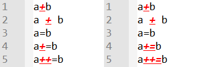
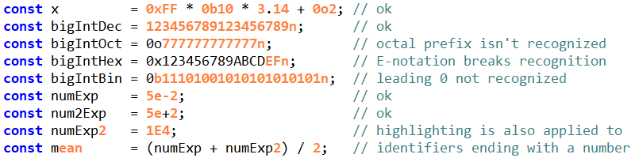
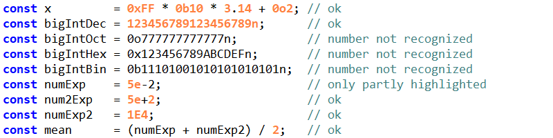
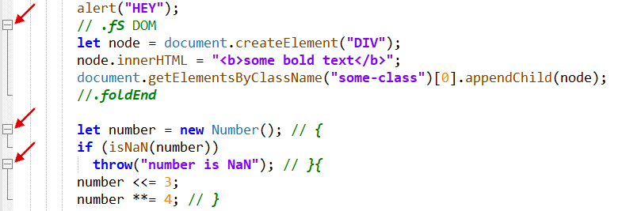

# User Defined Language (UDL) for Single-File Components (SFC) / .vue files in Notepad++
This project provides a quick and simple way to enhance the (development) experience of Vue single-file components in Notepad++.  
Resources for further customization are also provided.
Please read on to learn about what is possible and some restrictions of this UDL.

## Quick setup
1. Download `Vue.xml` or `Vue-dark.xml`
2. Open Notepad++ and go to *Language -> User Defined Language -> Define your language*
3. Click *Import*
4. Select the XML-file you saved
5. Close the dialog and restart Notepad++
6. Go to *Language* again and select `Vue` or `Vue (dark)` right under *User Defined Language* to enable the highlighting for any *.vue* file in your current session

Notepad++ should automatically select the language for every *.vue* file opened from now on.
> [!TIP]
> To customize this UDL, go to *Language -> User Defined Language -> Define your language* and select `Vue` or `Vue (dark)` in the dropdown menu.

Colors and font (sizes) are quite simple to change but you might want to read further below before making other changes.

> [!TIP]
> When changing style settings, don't select anything for *font* and *size* and keep the background transparent. That way, [issues](https://github.com/J0NEK0/NotepadPlusPlus-Vue-UDL/issues/3) can be avoided when using a different theme.

## Styles
Overview over the styles used in this UDL:
| Name | Color & Style | Color & Style dark | Description |
|:-----|:-------------:|:------------------:|:------------|
| Default style | `inherit` | `inherit` | Default styling of every non-keyword *outside* the delimiter environments |
| Folding in comment | `#008000`, **bold** & *italic* | `#7F9F7F`, **bold** & *italic* | Markers for folding (`{`, `}`, `.fS`, `.foldEnd`, ...) |
| Folding in code | | | Folding markes in code (unused) |
| Keywords 1 | `#0000FF`, **bold** | `#DFC47D`, **bold** | JS core (`this`, `super`, `if`, ...) |
| Keywords 2 | `#0080C0` | `#0080C0` | JS global objects |
| Keywords 3 | `#804000` | `#FFCFAF` | JS global (object) function properties (`toString`, `eval`, `isNaN`, ...) |
| Keywords 4 | `#0000FF`, **bold** | `#E3CEAB`, **bold** | HTML tags (`div`, `html`, `a`, `p`, ...) |
| Keywords 5 | `#FF0000` | `#DFDFDF` | HTML attributes (`id`, `class`, `style`, `alt`, ...) |
| Keywords 6 | `#8080C0`, **bold** | `#C2BE9E`, **bold** | CSS rules, pseudo-classes & -elements and properties |
| Keywords 7 | `#42b883` | `#42b883` | Vue HTML tags and attributes (`v-if`, `KeepAlive`, `@`, `:`, ...) |
| Keywords 8 | `#42b883` | `#42b883` | Vue JS properties and functions (`createApp`, `emit`, `onMounted`, ...) |
| Comment line | `#008000` | `#7F9F7F` | One-line comments (JS) |
| Comment | `#008000` | `#7F9F7F` | Multi-line comments (JS, CSS) |
| Number | `#FF8000` | `#8CD0D3` | Numbers |
| Operators 1 | `inherit` | `inherit` | Operators (`+`, `*`, `/`, `=`, `&`, ...) |
| Operators 2 | `inherit` | `inherit` | Operators surrounded by space (`-`) |
| Delimiter 1 | `inherit` | `inherit` | CSS default style |
| Delimiter 2 | `inherit` | `inherit` | JS default style |
| Delimiter 3 | `inherit` | `inherit` | HTML default style |
| Delimiter 4 | `#008000` | `#7F9F7F` | HTML comment |
| Delimiter 5 | `inherit` | `inherit` | HTML tag & attribute environment (`< >`, `</ >`) |
| Delimiter 6 | `#8000FF` | `#CC9393` | Strings (`" "`)|
| Delimiter 7 | `#808080` | `#CC9393` | Template strings |
| Delimiter 8 | `#42b883` | `#42b883` | Text interpolation / Mustaches (`{{`, `}}`) |


# How it's (not) working
A typical single-file component consists of three parts: *template*, *script* and *style*.
Basically all that needs to be done is to apply the existing rules for *HTML*, *JavaScript* and *CSS* to the correct parts of the code and add the keywords for Vue.
However, while the UDL functionality of Notepad++ allows the creation of many languages, only one language can be selected for a file, which is then applied to the *whole* content of the file.
This suggests that all keywords from all languages would have to be merged together but then the *JavaScript* keywords would also be highlighted in the *template* section and so on.  
To avoid this, this UDL makes use of delimiters.
Nevertheless, this approach still requires some language-mixing and waiver of some typical features.
Let's go through the settings:

> [!IMPORTANT]
> The global property **Ignore case** is set to `false`.

While HTML and CSS (with the exception of *class* and *id* selectors as well as values of some properties) aren't case sensitive, JavaScript and XHTML are.
Lower case must be used in order for keywords to be detected. 
If you are more of an ALL-CAPS person, transform and replace/add the respective keywords:
```
"space separated keywords".split(" ").map(x => x.toUpperCase()).join(" ")
```


## Operators & Delimiters
Delimiters and the nesting function are used to apply specific rules to a specific part of the *.vue* file.
Code between
- `<style ... </style>` will have a highlighting similar to CSS
- `<script ... </script>` will be highlighted like JavaScript for the most part and also highlight Vue keywords
- `<template ... </template>` will have an HTML-like highlighting
- `<!--...-->` will be highlighted as HTML comment
- `<...>` and `</...>` will be highlighted like an HTML tag
- `"..."` and `'...'` will be marked as string with the possibility to escape using `\`, e. g. `"abc\"def"` will be highlighted as a single string
- `` `...` `` will be highlighted similar to a template string, again with the possibility to escape using `\`
- `{{...}}` will be highlighted in a Vue-like fashion

Notepad++ UDL distinguishes between two kinds of operators.
The first kind (Operators 1) can be glued to any variable or keyword, e.g. `+=` in `i+=1`, and the other kind (Operators 2) needs whitespace around it like `instanceof` in `x instanceof Object` (essentially becomig another set of keywords).
> [!NOTE]
> Observation: Operators appear to be processed after delimiters. When a token (e. g. `#`) is defined as operator but also used as (part of) an openening / closing token of a delimiter as well, the styling of the delimiter is applied.  

The operator may still appear (styled as such) in or outside of the delimiter range, depending on the exact definition of the opening / closing of the delimiter and whether nesting has been activated.
This behavior actually makes it possible to improve the HTML highlighting using an additional layer of nesting.

When defining the first kind of operators (Operators 1) it is important to know that the order of the individual operators matters.  
  
Operators are marked red in the image above.
On the left side, Operators 1 was defined as `+ +=` and on the right side vice versa, i. e. `+= +`.
The difference can be observed in line 4 and 5: the operator defined first is matched.  
Similarly, the order of delimiters is also important for the highlighting behavior.
If Delimiter 4 (HTML comment) and Delimiter 5 (HTML tag) were defined the other way around, HTML comment highlighting would break since it would never be applied.
> [!IMPORTANT]
> Given a set of operators or delimiters, any operators/delimiters that are a prefix of another operator/delimiter in the set should be defined *after* the operator/delimiter they are the prefix of.

Of course, if `+` as well as `=` are defined as operators, `+=`, `++`, `==` and so on become redundant.

Operators of the first kind are usually special characters:

<details>

<summary>Special characters / sequences</summary>

|Operator|Language|Name|
|:------:|:------:|:---|
| = | JS, HTML, CSS | Assignment (x2), attribute equality |
| += | JS | Addition assignment |
| -= | JS | Subtraction assignment |
| *= | JS, CSS | Multiplication assignment, attribute substring containment |
| /= | JS | Division assignment |
| %= | JS | Remainder assignment |
| **= | JS | Exponentiation assignment |
| <<= | JS | Left shift assignment |
| >>= | JS | Right shift assignment |
| >>>= | JS | Unsigned right shift assignment |
| &= | JS | Bitwise AND assignment |
| ^= | JS, CSS | Bitwise XOR assignment, attribute beginning equality |
| \|= | JS, CSS | Bitwise OR assignment, attribute prefix equality |
| &&= | JS | Logical AND assignment |
| \|\|= | JS | Logical AND assignment |
| ??= | JS | Nullish coalescing assignment |
| == | JS | Equal |
| != | JS | Not equal |
| === | JS | Strict equal |
| !== | JS | Strict not equal |
| > | JS, HTML, CSS | Greater than, tag end, child combinator |
| >= | JS | Greater than or equal |
| < | JS, HTML | Less than, tag start |
| <= | JS | Less than or equal |
| % | JS | Remainder |
| ** | JS | Exponentiation |
| ++ | JS | Increment |
| -- | JS | Decrement |
| - | JS | Subtraction / unary negation |
| + | JS | Addition / unary plus, next-sibling combinator |
| * | JS, CSS | Multiplication, all elements selector |
| / | JS | Division |
| & | JS, HTML, CSS | Bitwise AND, entity definition, nesting selector |
| \| | JS, CSS | Bitwise OR, namespace separator |
| ^ | JS | Bitwise XOR |
| ~ | JS, CSS | Bitwise NOT, Subsequent-sibling combinator |
| << | JS | Left shift |
| >> | JS | Right shift |
| >>> | JS | Unsigned right shift |
| && | JS | Logical AND |
| \|\| | JS | Logical OR |
| ! | JS | Logical NOT |
| ?? | JS | Nullish coalescing |
| ? | JS | Ternary operator |
| , | JS, CSS | Comma operator, selector list |
| ~= | CSS | Attribute containment |
| $= | CSS | Attribute ending equality |
| => | JS | Arrow function |
| ( ) | JS, CSS | Grouping operator / function, function |
| { } | JS, CSS | Object definition / function definition, rule definition |
| [ ] | JS, CSS | Property accessor / array definition, attribute selector |
| . | JS, CSS | Property accessor, class selector |
| ... | JS | Destructuring |
| ?. | JS | Optional chaining |
| ; | JS, CSS | Statement (x2) |
| : | JS, CSS | Object attribute definition, property value definition |
| / / | JS | Regular expression |
| " " | JS, HTML, CSS | String, attribute value, string |
| ' ' | JS, HTML, CSS | String, attribute value, string |
| \` \` | JS | Template string |
| $ | JS | Template string interpolation |
| # | JS, CSS | Private member, id selector |

</details>

Operators of the first kind are limited to one set Operators 1.
This restriction poses a problem: 
While there is overlap between the operators of JS, CSS and HTML, not everything is compatible, which results in semantically incorrect highlighting in some cases.  
Especially `-` causes problems:
If `-` is defined in Operators 1, as it should be from a JavaScript perspective, almost all Vue directives won't be identifed anymore, since they contain a `-` and thus count as two words instead (e. g. `v-if` becomes `v`and `if`).
Not enabling (nesting) Operators 1 in the *template*-part would be possible thanks to the string delimiter but has some drawbacks (`=` might be part of every keyword and Vue-modifiers need special treatment).
The same cannot be applied to CSS, where an abundance of keywords contain `-`.
Not enabling Operators 1 inside the *style*-part isn't really an option, because any meaningful highlighting becomes essentially impossible (or at least dependent on the coding style/space usage).

Leaving out strings, Operators 1 is thus defined as
```
* / + -- $= = % ^ < > & | ? ! ~ , . ; : ( ) [ ] { }
```

and Operators 2 as
```
-
```

> [!IMPORTANT]
> When writing the JavaScript code, ensure whitespace around both sides of the `-` operator to prevent faulty highlighting.


## Keywords

Up to eight sets of keywords can be defined, each with their own styling setting.
Attention should be paid to the order of keyword definitions.
When a keyword is defined in multiple sets, i. e. the sets aren't disjoint, its highlighting will be determined by the first set of keywords defining that keyword.  
Example: The keyword `for` is defined in Keywords 1 (JS core, `for`-loop) and Keywords 3 (JS properties, `Symbol.for()`) and will therefore be highlighted according to style defined for Keywords 1, i. e. as a JS core keyword.

The keywords for all three languages as well as Vue have to be distributed across these sets.
Notepad++ comes with build-in support for HTML, CSS and JavaScript.
The definition of the corresponding keywords can be found in the `langs.model.xml` file located in the installation directory.
The respective styles reside in `stylers.model.xml`.

> [!TIP]
> Recombine the keyword sets provided in [/resources](/resources/README.md) to quickly adapt the keywords to your needs.

---
### HTML
There are two main components in the HTML language with respect to keywords: tags and attributes.
Notepad++ only defines one set of keywords named `instre1` which contains tags as well as attributes:
<details>

<summary>HTML - instre1</summary>

```
!doctype ^data- a abbr accept accept-charset accesskey acronym action address align alink alt applet archive area article aside async audio autocomplete autofocus axis b background base basefont bdi bdo bgcolor bgsound big blink blockquote body border br button canvas caption cellpadding cellspacing center char charoff charset checkbox checked cite class classid clear code codebase codetype col colgroup color cols colspan command compact content contenteditable contextmenu coords data datafld dataformatas datalist datapagesize datasrc datetime dd declare defer del details dfn dialog dir disabled div dl draggable dropzone dt element em embed enctype event face fieldset figcaption figure file font footer for form formaction formenctype formmethod formnovalidate formtarget frame frameborder frameset h1 h2 h3 h4 h5 h6 head header headers height hgroup hidden hr href hreflang hspace html http-equiv i id iframe image img input ins isindex ismap kbd keygen label lang language leftmargin legend li link list listing longdesc main manifest map marginheight marginwidth mark marquee max maxlength media menu menuitem meta meter method min minlength multicol multiple name nav nobr noembed noframes nohref noresize noscript noshade novalidate nowrap object ol onabort onafterprint onautocomplete onautocompleteerror onbeforeonload onbeforeprint onblur oncancel oncanplay oncanplaythrough onchange onclick onclose oncontextmenu oncuechange ondblclick ondrag ondragend ondragenter ondragleave ondragover ondragstart ondrop ondurationchange onemptied onended onerror onfocus onhashchange oninput oninvalid onkeydown onkeypress onkeyup onload onloadeddata onloadedmetadata onloadstart onmessage onmousedown onmouseenter onmouseleave onmousemove onmouseout onmouseover onmouseup onmousewheel onoffline ononline onpagehide onpageshow onpause onplay onplaying onpointercancel onpointerdown onpointerenter onpointerleave onpointerlockchange onpointerlockerror onpointermove onpointerout onpointerover onpointerup onpopstate onprogress onratechange onreadystatechange onredo onreset onresize onscroll onseeked onseeking onselect onshow onsort onstalled onstorage onsubmit onsuspend ontimeupdate ontoggle onundo onunload onvolumechange onwaiting optgroup option output p param password pattern picture placeholder plaintext pre profile progress prompt public q radio readonly rel required reset rev reversed role rows rowspan rp rt rtc ruby rules s samp sandbox scheme scope scoped script seamless section select selected shadow shape size sizes small source spacer span spellcheck src srcdoc srcset standby start step strike strong style sub submit summary sup svg svg:svg tabindex table target tbody td template text textarea tfoot th thead time title topmargin tr track tt type u ul usemap valign value valuetype var version video vlink vspace wbr width xml xmlns xmp
```
</details>

There are, however, 14 styles defined (not including eight additional styles that can be defined by the user): `DEFAULT`, `COMMENT`, `NUMBER`, `DOUBLE STRING`, `SINGLE STRING`, `TAG`, `TAG END`, `TAG UNKNOWN`, `ATTRIBUTE`, `ATTRIBUTE UNKNOWN`, `SGML DEFAULT`, `CDATA`, `VALUE`, `ENTITY`.
The processing of native HTML is different from the way a UDL is processed.


As shown in the image above: The first keyword in native HTML is highlighted in style `TAG` or `TAG END`, all others in style `ATTRIBUTE` while inside `< >`.
If the tag/attribute isn't known, styles `TAG UNKNOWN` and `ATTRIBUTE UNKNOWN` are applied instead.
To replicate this behavior, at least two sets of keywords must be used.
This UDL therefore defines Keywords 4 and Keywords 5.

<details>

<summary>HTML keyword definitions</summary>

| Keyword-Set | Description | Keywords |
|:-----------:|:-----------:|:---------|
| 4th group   | HTML tags   | `doctype a abbr address area article aside audio b base bdi bdo blockquote body br button canvas caption cite code col colgroup data datalist dd del details dfn dialog div dl dt em embed fieldset figcaption figure footer form h1 h2 h3 h4 h5 h6 head header hgroup hr html i iframe img input ins kbd label legend li link main map mark menu meta meter nav noscript object ol optgroup option output p param picture pre progress q rp rt ruby s samp script search section select slot small source span strong style sub summary sup table tbody td template textarea tfoot th thead time title tr track u ul var video wbr` |
| 5th group   | HTML attributes   | `abbr accept accept-charset accesskey accesskey action allow alt as async autocapitalize autocomplete autocorrect autofocus autoplay blocking capture charset checked cite class cols colspan command commandfor content contenteditable controls controlslist coords crossorigin data datetime decoding default defer dir dirname disabled disablepictureinpicture disableremoteplayback download draggable elementtiming enctype enterkeyhint exportparts fetchpriority filename for form formaction formenctype formmethod formnovalidate formtarget headers height hidden high href hreflang http-equiv id imagesizes imagesrcset inert inputmode integrity is ismap itemid itemprop itemref itemscope itemtype kind label lang list loading loop low max maxlength media method min minlength multiple muted name nomodule nonce novalidate open optimum part pattern ping placeholder playsinline popover popovertarget popovertargetaction poster preload readonly referrerpolicy rel required reversed rows rowspan sandbox scope selected shadowrootclonable shadowrootdelegatesfocus shadowrootmode shape size sizes slot span spellcheck src srcdoc srclang srcset start step style tabindex target title translate type usemap value width wrap writingsuggestions xmlns` |

</details>


---
### CSS
Native CSS in Notepad++ defines four sets of keywords
| Keyword-Set | Style |
|:--------|:------|
|`instre1`|`IDENTIFIER`|
|`instre2`|`PSEUDOCLASS`|
|`type3`  |`PSEUDOELEMENT`|
|`type4`  |`LEGACY PSEUDOELEMENT`|

<details>

<summary>instre1</summary>

`instre1` contains CSS properties.
```
-khtml-background-clip -khtml-background-origin -khtml-background-size -khtml-border-bottom-left-radius -khtml-border-bottom-right-radius -khtml-border-radius -khtml-border-top-left-radius -khtml-border-top-right-radius -khtml-opacity -moz-animation -moz-animation-delay -moz-animation-direction -moz-animation-duration -moz-animation-fill-mode -moz-animation-iteration-count -moz-animation-name -moz-animation-play-state -moz-animation-timing-function -moz-appearance -moz-background-clip -moz-background-inline-policy -moz-background-origin -moz-background-size -moz-binding -moz-border-bottom-colors -moz-border-end -moz-border-end-color -moz-border-end-style -moz-border-end-width -moz-border-image -moz-border-left-colors -moz-border-radius -moz-border-radius-bottomleft -moz-border-radius-bottomright -moz-border-radius-topleft -moz-border-radius-topright -moz-border-right-colors -moz-border-start -moz-border-start-color -moz-border-start-style -moz-border-start-width -moz-border-top-colors -moz-box-align -moz-box-direction -moz-box-flex -moz-box-flex-group -moz-box-flexgroup -moz-box-ordinal-group -moz-box-orient -moz-box-pack -moz-box-shadow -moz-box-sizing -moz-column-count -moz-column-gap -moz-column-rule -moz-column-rule-color -moz-column-rule-style -moz-column-rule-width -moz-column-width -moz-context-properties -moz-float-edge -moz-force-broken-image-icon -moz-image-region -moz-linear-gradient -moz-margin-end -moz-margin-start -moz-opacity -moz-outline -moz-outline-color -moz-outline-offset -moz-outline-radius -moz-outline-radius-bottomleft -moz-outline-radius-bottomright -moz-outline-radius-topleft -moz-outline-radius-topright -moz-outline-style -moz-outline-width -moz-padding-end -moz-padding-start -moz-radial-gradient -moz-stack-sizing -moz-text-decoration-color -moz-text-decoration-line -moz-text-decoration-style -moz-transform -moz-transform-origin -moz-transition -moz-transition-delay -moz-transition-duration -moz-transition-property -moz-transition-timing-function -moz-user-focus -moz-user-input -moz-user-modify -moz-user-select -moz-window-shadow -ms-filter -ms-transform -ms-transform-origin -o-transform -webkit-animation -webkit-animation-delay -webkit-animation-direction -webkit-animation-duration -webkit-animation-fill-mode -webkit-animation-iteration-count -webkit-animation-name -webkit-animation-play-state -webkit-animation-timing-function -webkit-appearance -webkit-backface-visibility -webkit-background-clip -webkit-background-composite -webkit-background-origin -webkit-background-size -webkit-border-bottom-left-radius -webkit-border-bottom-right-radius -webkit-border-horizontal-spacing -webkit-border-image -webkit-border-radius -webkit-border-top-left-radius -webkit-border-top-right-radius -webkit-border-vertical-spacing -webkit-box-align -webkit-box-direction -webkit-box-flex -webkit-box-flex-group -webkit-box-lines -webkit-box-ordinal-group -webkit-box-orient -webkit-box-pack -webkit-box-reflect -webkit-box-shadow -webkit-box-sizing -webkit-column-break-after -webkit-column-break-before -webkit-column-break-inside -webkit-column-count -webkit-column-gap -webkit-column-rule -webkit-column-rule-color -webkit-column-rule-style -webkit-column-rule-width -webkit-column-width -webkit-columns -webkit-dashboard-region -webkit-font-smoothing -webkit-gradient -webkit-line-break -webkit-linear-gradient -webkit-margin-bottom-collapse -webkit-margin-collapse -webkit-margin-start -webkit-margin-top-collapse -webkit-marquee -webkit-marquee-direction -webkit-marquee-increment -webkit-marquee-repetition -webkit-marquee-speed -webkit-marquee-style -webkit-mask -webkit-mask-attachment -webkit-mask-box-image -webkit-mask-clip -webkit-mask-composite -webkit-mask-image -webkit-mask-origin -webkit-mask-position -webkit-mask-position-x -webkit-mask-position-y -webkit-mask-repeat -webkit-mask-size -webkit-nbsp-mode -webkit-padding-start -webkit-perspective -webkit-perspective-origin -webkit-radial-gradient -webkit-rtl-ordering -webkit-tap-highlight-color -webkit-text-fill-color -webkit-text-security -webkit-text-size-adjust -webkit-text-stroke -webkit-text-stroke-color -webkit-text-stroke-width -webkit-touch-callout -webkit-transform -webkit-transform-origin -webkit-transform-origin-x -webkit-transform-origin-y -webkit-transform-origin-z -webkit-transform-style -webkit-transition -webkit-transition-delay -webkit-transition-duration -webkit-transition-property -webkit-transition-timing-function -webkit-user-drag -webkit-user-modify -webkit-user-select align-content align-items align-self alignment-adjust alignment-baseline all animation animation-delay animation-direction animation-duration animation-fill-mode animation-iteration-count animation-name animation-play-state animation-timing-function appearance azimuth backface-visibility background background-attachment background-blend-mode background-break background-clip background-color background-image background-origin background-position background-position-x background-position-y background-repeat background-size baseline-shift binding bleed block-size bookmark-label bookmark-level bookmark-state bookmark-target border border-block border-block-end border-block-start border-bottom border-bottom-color border-bottom-left-radius border-bottom-right-radius border-bottom-style border-bottom-width border-collapse border-color border-image border-image-outset border-image-repeat border-image-slice border-image-source border-image-width border-inline border-inline-end border-inline-end-width border-inline-start border-inline-start-color border-inline-start-style border-inline-start-width border-left border-left-color border-left-style border-left-width border-radius border-right border-right-color border-right-style border-right-width border-spacing border-style border-top border-top-color border-top-left-radius border-top-right-radius border-top-style border-top-width border-width bottom box-align box-decoration-break box-direction box-flex box-flex-group box-lines box-ordinal-group box-orient box-pack box-shadow box-sizing break-after break-before break-inside caption-side caret-color clear clip color color-profile column-count column-fill column-gap column-rule column-rule-color column-rule-style column-rule-width column-span column-width columns content counter-increment counter-reset crop cue cue-after cue-before cursor direction display dominant-baseline drop-initial-after-adjust drop-initial-after-align drop-initial-before-adjust drop-initial-before-align drop-initial-size drop-initial-value elevation empty-cells fill fill-opacity filter fit fit-position flex flex-basis flex-direction flex-flow flex-grow flex-shrink flex-wrap float float-offset font font-effect font-emphasize font-family font-size font-size-adjust font-stretch font-style font-variant font-variant-ligatures font-weight gap grid-area grid-auto-flow grid-auto-rows grid-column grid-column-end grid-column-gap grid-column-start grid-columns grid-gap grid-row grid-row-gap grid-rows grid-template-areas grid-template-columns grid-template-rows hanging-punctuation height hyphenate-after hyphenate-before hyphenate-character hyphenate-lines hyphenate-resource hyphens icon image-orientation image-rendering image-resolution inline-box-align inline-size inset inset-inline-end inset-inline-start justify-content justify-items justify-self left letter-spacing line-height line-stacking line-stacking-ruby line-stacking-shift line-stacking-strategy list-style list-style-image list-style-position list-style-type margin margin-block margin-block-end margin-block-start margin-bottom margin-inline margin-inline-end margin-inline-start margin-left margin-right margin-top mark mark-after mark-before marker-offset marks marquee-direction marquee-play-count marquee-speed marquee-style mask mask-clip mask-image mask-origin mask-position mask-position-x mask-repeat mask-size max-height max-width min-block-size min-height min-inline-size min-width mix-blend-mode move-to nav-down nav-index nav-left nav-right nav-up object-fit opacity order orphans outline outline-color outline-offset outline-style outline-width overflow overflow-anchor overflow-style overflow-wrap overflow-x overflow-y padding padding-block padding-block-end padding-block-start padding-bottom padding-inline padding-inline-end padding-inline-start padding-left padding-right padding-top page page-break-after page-break-before page-break-inside page-policy paint-order pause pause-after pause-before perspective perspective-origin phonemes pitch pitch-range play-during pointer-events position presentation-level punctuation-trim quotes rendering-intent resize rest rest-after rest-before richness right rotation rotation-point ruby-align ruby-overhang ruby-position ruby-span scrollbar-color size speak speak-header speak-numeral speak-punctuation speech-rate stress string-set stroke stroke-dasharray stroke-linejoin stroke-opacity stroke-width tab-size table-layout target target-name target-new target-position text-align text-align-last text-anchor text-decoration text-decoration-color text-decoration-line text-decoration-style text-emphasis text-height text-indent text-justify text-outline text-overflow text-rendering text-shadow text-transform text-wrap top transform transform-origin transform-style transition transition-delay transition-duration transition-property transition-timing-function unicode-bidi user-select vector-effect vertical-align visibility voice-balance voice-duration voice-family voice-pitch voice-pitch-range voice-rate voice-stress voice-volume volume white-space white-space-collapse widows width will-change word-break word-spacing word-wrap z-index
```

</details>

<details>

<summary>instre2</summary>

`instre2` contains CSS pseudo classes.
```
active any-link autofill checked default defined disabled empty enabled first first-child first-of-type focus focus-visible focus-within fullscreen has host hover in-range indeterminate invalid is lang last-child last-of-type left link modal not nth-child nth-last-child nth-last-of-type nth-of-type only-child only-of-type optional out-of-range placeholder-shown read-only read-write required right root scope target valid visited where
```

</details>

<details>

<summary>type3</summary>

`type3` contains CSS pseudo elements.
```
after backdrop before cue first-letter first-line file-selector-button marker part placeholder selection slotted
```

</details>

<details>

<summary>type4</summary>

`type4` contains "legacy" CSS pseudo elements.
```
after before first-letter first-line
```

</details>

Additionally the styles `DEFAULT`, `TAG`, `CLASS`, `UNKNOWN PSEUDOCLASS`, `OPERATOR`, `UNKNOWN IDENTIFIER`, `VALUE`, `COMMENT`, `ID`, `IMPORTANT`, `DIRECTIVE`, `DOUBLE STRING`, `SINGLE STRING`, `ATTRIBUTE`, `MEDIA` and `VARIABLE` are defined.

Some of the underlying keywords will have to be merged, as the number of available keyword sets is limited.
In fact, CSS could be considered the looser when compared to JS and HTML, as there is only one set of keywords distinctly allocated for CSS: Keywords 6.
Given the nature of CSS, this should still result in reasonable highlighting.
Nesting of HTML tags and attributes further enhances this but can be disabled if not desired.

<details>

<summary>Keywords 6</summary>

Keywords 6th group contains CSS properties, pseudo-classes, pseudo-elements, value functionas and at-rules.
```
-webkit-text-fill-color -webkit-text-stroke -webkit-text-stroke-color -webkit-text-stroke-width @annotation @character-variant @charset @color-profile @container @counter-style @font-face @font-feature-values @font-palette-values @import @keyframes @layer @media @namespace @ornaments @page @position-try @property @scope @starting-style @styleset @stylistic @supports @swash @view-transition abs accent-color acos active after align-content align-items align-self alignment-baseline all animation animation-composition animation-delay animation-direction animation-duration animation-fill-mode animation-iteration-count animation-name animation-play-state animation-timing-function any-link appearance asin aspect-ratio atan atan2 attr autofill backdrop backdrop-filter backface-visibility background background-attachment background-blend-mode background-clip background-color background-image background-origin background-position background-position-x background-position-y background-repeat background-size before block-size blur border border-block border-block-color border-block-end border-block-end-color border-block-end-style border-block-end-width border-block-start border-block-start-color border-block-start-style border-block-start-width border-block-style border-block-width border-bottom border-bottom-color border-bottom-left-radius border-bottom-right-radius border-bottom-style border-bottom-width border-collapse border-color border-end-end-radius border-end-start-radius border-image border-image-outset border-image-repeat border-image-slice border-image-source border-image-width border-inline border-inline-color border-inline-end border-inline-end-color border-inline-end-style border-inline-end-width border-inline-start border-inline-start-color border-inline-start-style border-inline-start-width border-inline-style border-inline-width border-left border-left-color border-left-style border-left-width border-radius border-right border-right-color border-right-style border-right-width border-spacing border-start-end-radius border-start-start-radius border-style border-top border-top-color border-top-left-radius border-top-right-radius border-top-style border-top-width border-width bottom box-decoration-break box-shadow box-sizing break-after break-before break-inside brightness buffering calc caption-side caret-color checked circle clamp clear clip-path clip-rule color color color-interpolation color-interpolation-filters color-mix color-scheme column-count column-fill column-gap column-rule column-rule-color column-rule-style column-rule-width column-span column-width columns conic-gradient contain contain-intrinsic-block-size contain-intrinsic-height contain-intrinsic-inline-size contain-intrinsic-size contain-intrinsic-width container container-name container-type content content-visibility contrast cos counter counter-increment counter-reset counter-set counters cross-fade cubic-bezier cue cursor cx cy d default defined details-content device-cmyk dir direction disabled display dominant-baseline drop-shadow ellipse empty empty-cells enabled env exp file-selector-button fill fill-opacity fill-rule filter first first-child first-letter first-line first-of-type fit-content flex flex-basis flex-direction flex-flow flex-grow flex-shrink flex-wrap float flood-color flood-opacity focus focus-visible focus-within font font-family font-feature-settings font-kerning font-language-override font-optical-sizing font-palette font-size font-size-adjust font-style font-synthesis font-synthesis-small-caps font-synthesis-style font-synthesis-weight font-variant font-variant-alternates font-variant-caps font-variant-east-asian font-variant-emoji font-variant-ligatures font-variant-numeric font-variant-position font-variation-settings font-weight forced-color-adjust fullscreen future gap grammar-error grayscale grid grid-area grid-auto-columns grid-auto-flow grid-auto-rows grid-column grid-column-end grid-column-start grid-row grid-row-end grid-row-start grid-template grid-template-areas grid-template-columns grid-template-rows hanging-punctuation has has-slotted height highlight host host-context hover hsl hue-rotate hwb hyphenate-character hyphenate-limit-chars hyphens hypot image image-orientation image-rendering image-set important in-range indeterminate initial-letter inline-size inset inset inset-block inset-block-end inset-block-start inset-inline inset-inline-end inset-inline-start invalid invert is isolation justify-content justify-items justify-self lab lang last-child last-of-type layer lch left left letter-spacing light-dark lighting-color line-break line-clamp line-height linear linear-gradient link list-style list-style-image list-style-position list-style-type log margin margin-block margin-block-end margin-block-start margin-bottom margin-inline margin-inline-end margin-inline-start margin-left margin-right margin-top marker marker marker-end marker-mid marker-start mask mask-border mask-border-mode mask-border-outset mask-border-repeat mask-border-slice mask-border-source mask-border-width mask-clip mask-composite mask-image mask-mode mask-origin mask-position mask-repeat mask-size mask-type math-depth math-style matrix matrix3d max max-block-size max-height max-inline-size max-width min min-block-size min-height min-inline-size min-width minmax mix-blend-mode mod modal muted not nth-child nth-last-child nth-last-of-type nth-of-type object-fit object-position offset offset-anchor offset-distance offset-path offset-position offset-rotate oklab oklch only-child only-of-type opacity opacity open optional order orphans out-of-range outline outline-color outline-offset outline-style outline-width overflow overflow-anchor overflow-block overflow-clip-margin overflow-inline overflow-wrap overflow-x overflow-y overscroll-behavior overscroll-behavior-block overscroll-behavior-inline overscroll-behavior-x overscroll-behavior-y padding padding-block padding-block-end padding-block-start padding-bottom padding-inline padding-inline-end padding-inline-start padding-left padding-right padding-top page paint paint-order part past path paused perspective perspective perspective-origin picture-in-picture place-content place-items place-self placeholder placeholder-shown playing pointer-events polygon popover-open position pow print-color-adjust quotes r radial-gradient ray read-only read-write rect rem repeat repeat-conic-gradient repeat-linear-gradient repeat-radial-gradietn required resize rgb right right root rotate rotate rotate3d rotateX rotateY rotateZ round row-gap ruby-align ruby-position rx ry saturate scale scale scale3d scaleX scaleY scaleZ scope scroll-behavior scroll-margin scroll-margin-block scroll-margin-block-end scroll-margin-block-start scroll-margin-bottom scroll-margin-inline scroll-margin-inline-end scroll-margin-inline-start scroll-margin-left scroll-margin-right scroll-margin-top scroll-padding scroll-padding-block scroll-padding-block-end scroll-padding-block-start scroll-padding-bottom scroll-padding-inline scroll-padding-inline-end scroll-padding-inline-start scroll-padding-left scroll-padding-right scroll-padding-top scroll-snap-align scroll-snap-stop scroll-snap-type scrollbar-color scrollbar-gutter scrollbar-width seeking selection sepia shape shape-image-threshold shape-margin shape-outside shape-rendering sign sin skew skewX skewY slotted spelling-error sqrt stalled state steps stop-color stop-opacity stroke stroke-dasharray stroke-dashoffset stroke-linecap stroke-linejoin stroke-miterlimit stroke-opacity stroke-width symbols tab-size table-layout tan target target-text text-align text-align-last text-anchor text-box text-box-edge text-box-trim text-combine-upright text-decoration text-decoration-color text-decoration-line text-decoration-skip-ink text-decoration-style text-decoration-thickness text-emphasis text-emphasis-color text-emphasis-position text-emphasis-style text-indent text-justify text-orientation text-overflow text-rendering text-shadow text-transform text-underline-offset text-underline-position text-wrap text-wrap-mode text-wrap-style top touch-action transform transform-box transform-origin transform-style transition transition-behavior transition-delay transition-duration transition-property transition-timing-function translate translate translate3d translateX translateY translateZ unicode-bidi url user-invalid user-select user-valid var vector-effect vertical-align view-transition view-transition-class view-transition-group view-transition-image-pair view-transition-name view-transition-new view-transition-old visibility visited volume-locked where white-space white-space-collapse widows width will-change word-break word-spacing writing-mode x xywh y z-index zoom
```

</details>


---
### JavaScript
Three sets of keywords are defined for native JavaScript in Notepad++:
| Keyword | Style |
|:--------|:------|
|`instre1`|`INSTRUCTION WORD`|
|`instre2`|`WINDOW INSTRUCTION`|
|`type1`  |`TYPE WORD`|

<details>

<summary>instre1</summary>

`instre1` contains JavaScript core keywords as well as future reserved keywords.
```
abstract async await boolean break byte case catch char class const continue debugger default delete do double else enum export extends final finally float for function goto if implements import in instanceof int interface let long native new null of package private protected public return short static super switch synchronized this throw throws transient try typeof var void volatile while with true false prototype yield
```

</details>

<details>

<summary>type1</summary>

`type1` contains some JavaScript core built-in objects as well as functions.
```
Array Date eval hasOwnProperty Infinity isFinite isNaN isPrototypeOf Math NaN Number Object prototype String toString undefined valueOf
```

</details>

<details>

<summary>instre2</summary>

`instre2` contains window keywords, i. e. methods and properties of the `window`object as well as some other keywords (`pkcs11`, ...).
```
alert all anchor anchors area assign blur button checkbox clearInterval clearTimeout clientInformation close closed confirm constructor crypto decodeURI decodeURIComponent defaultStatus document element elements embed embeds encodeURI encodeURIComponent escape event fileUpload focus form forms frame innerHeight innerWidth layer layers link location mimeTypes navigate navigator frames frameRate hidden history image images offscreenBuffering onblur onclick onerror onfocus onkeydown onkeypress onkeyup onmouseover onload onmouseup onmousedown onsubmit open opener option outerHeight outerWidth packages pageXOffset pageYOffset parent parseFloat parseInt password pkcs11 plugin prompt propertyIsEnum radio reset screenX screenY scroll secure select self setInterval setTimeout status submit taint text textarea top unescape untaint window
```

</details>

Additionally the styles `DEFAULT`, `NUMBER`, `STRING`, `STRING RAW`, `CHARACTER`, `OPERATOR`, `VERBATIM`, `REGEX`, `COMMENT`, `COMMENT LINE`, `COMMENT DOC`, `COMMENT LINE DOC`, `COMMENT DOC KEYWORD` and `COMMENT DOC KEYWORD ERROR` are defined.

Similar to the native definition of JavaScript, this UDL uses three sets of keywords for highlighting:
 - **Keywords 1**: JavaScript core keywords
 - **Keywords 2**: Built-in objects ("types")
 - **Keywords 3**: Functions/properties of the build-in objects

Keywords 1 and Keywords 2 are relatively intuitive in their definition, but especially Keywords 3 makes one flaw of this approach in combination with the UDL mechanism apparent: false positives.
Notepad++ UDL highlights every keyword, e. g. `join` would be highlighted in `Array.join()` as well as `Number.join()`, i. e. regardless of context.
Of course, "correctly" highlighting only the first `join` is outside of the scope of what a UDL can do.
It is technically even outside the scope of JavaScript and something that TypeScript tackles.
Nevertheless, the probability of such "wrong" highlightings increases with the number of keywords.
To avoid this, Keywords 3 should be kept to a minimum or, as a matter of preference, not be used at all.  
Regardless, this UDL includes all built-in objects as well as all their properties and methods (excluding experimental, non-standard and deprecated ones) and additionally a few choice objects from some WebAPIs (mainly DOM API).
The final definitions can be found below:
<details>

<summary>JavaScript keyword definitions</summary>

| Keyword-Set | Description | Keywords |
|:-----------:|:-----------:|:---------|
| 1st group   | core        | `break case catch class const continue debugger default delete do else export extends false finally for function if import in instanceof let new null return static super switch this throw true try typeof var void while with yield as async from of arguments prototype constructor get set enum implements interface package private protected public` |
| 2nd group   | Objects     | `AggregateError Array ArrayBuffer AsyncFunction AsyncGenerator AsyncGeneratorFunction AsyncIterator Atomics BigInt BigInt64Array BigUint64Array Boolean DataView Date Document Element Error EvalError Event EventTarget FinalizationRegistry Float16Array Float32Array Float64Array Function Generator GeneratorFunction Infinity Int16Array Int32Array Int8Array Intl Iterator JSON Map Math NaN Node Number Object Promise Proxy RangeError ReferenceError Reflect RegExp Set SharedArrayBuffer String Symbol SyntaxError Temporal TypeError TypedArray URIError Uint16Array Uint32Array Uint8Array Uint8ClampedArray WeakMap WeakRef WeakSet Window console document globalThis undefined window` |
| 3rd group   | Functions / properties| `BYTES_PER_ELEMENT E EPSILON LN10 LN2 LOG10E LOG2E MAX_SAFE_INTEGER MAX_VALUE MIN_SAFE_INTEGER MIN_VALUE NEGATIVE_INFINITY NaN PI POSITIVE_INFINITY SQRT1_2 SQRT2 URL UTC abs acos acosh activeElement add addEventListener adoptNode adoptedStyleSheets after alert all allSettled and animate any append appendChild apply ariaActiveDescendantElement ariaAtomic ariaAutoComplete ariaBrailleLabel ariaBrailleRoleDescription ariaBusy ariaChecked ariaColCount ariaColIndex ariaColIndexText ariaColSpan ariaControlsElements ariaCurrent ariaDescribedByElements ariaDescription ariaDetailsElements ariaDisabled ariaErrorMessageElements ariaExpanded ariaFlowToElements ariaHasPopup ariaHidden ariaInvalid ariaKeyShortcuts ariaLabel ariaLabelledByElements ariaLevel ariaLive ariaModal ariaMultiLine ariaMultiSelectable ariaOrientation ariaOwnsElements ariaPlaceholder ariaPosInSet ariaPressed ariaReadOnly ariaRequired ariaRoleDescription ariaRowCount ariaRowIndex ariaRowIndexText ariaRowSpan ariaSelected ariaSetSize ariaSort ariaValueMax ariaValueMin ariaValueNow ariaValueText asIntN asUintN asin asinh assert assign assignedSlot asyncIterator at atan atan2 atanh atob attachShadow attributes baseURI before bind body btoa bubbles buffer byteLength byteOffset caches call cancelAnimationFrame cancelIdleCallback cancelable captureStackTrace caretPositionFromPoint catch cause cbrt ceil charAt charCodeAt characterSet checkVisibility childElementCount childNodes children classList className clear clearInterval clearTimeout clientHeight clientInformation clientLeft clientTop clientWidth cloneNode close closed closest clz32 codePointAt compareDocumentPosition compareExchange compatMode composed composedPath computedStyleMap concat confirm construct contains contentType cookie cookieStore copyWithin cos cosh count countReset create createAttribute createAttributeNS createCDATASection createComment createDocumentFragment createElement createElementNS createExpression createImageBitmap createNodeIterator createProcessingInstruction createRange createTextNode createTreeWalker crossOriginIsolated crypto currentCSSZoom currentScript currentTarget customElements debug decodeURI decodeURIComponent defaultPrevented defaultView defineProperties defineProperty delete deleteProperty deref description designMode detached devicePixelRatio difference dir dirxml dispatchEvent doctype document documentElement documentURI dotAll drop elementFromPoint elementsFromPoint embeds encodeURI encodeURIComponent endsWith entries error escape eval evaluate eventPhase every exchange exec exitFullscreen exitPictureInPicture exitPointerLock exp expm1 f16round fetch fill filter finally find findIndex findLast findLastIndex firstChild firstElementChild flags flat flatMap floor focus fonts for forEach forms fragmentDirective frameElement frames freeze from fromAsync fromBase64 fromCharCode fromCodePoint fromEntries fromHex fround fullscreenElement fullscreenEnabled get getAnimations getAttribute getAttributeNS getAttributeNames getAttributeNode getAttributeNodeNS getBigInt64 getBigUint64 getBoundingClientRect getClientRects getComputedStyle getDate getDay getElementById getElementsByClassName getElementsByName getElementsByTagName getElementsByTagNameNS getFloat16 getFloat32 getFloat64 getFullYear getHTML getHours getInt16 getInt32 getInt8 getMilliseconds getMinutes getMonth getOwnPropertyDescriptor getOwnPropertyDescriptors getOwnPropertyNames getOwnPropertySymbols getPrototypeOf getRootNode getSeconds getSelection getTime getTimezoneOffset getUTCDate getUTCDay getUTCFullYear getUTCHours getUTCMilliseconds getUTCMinutes getUTCMonth getUTCSeconds getUint16 getUint32 getUint8 global group groupBy groupCollapsed groupEnd grow growable has hasAttribute hasAttributeNS hasAttributes hasChildNodes hasFocus hasIndices hasInstance hasOwn hasOwnProperty hasPointerCapture hasStorageAccess hasUnpartitionedCookieAccess head hidden history hypot id ignoreCase images implementation importNode imul includes indexOf indexedDB info innerHTML innerHeight innerWidth insertAdjacentElement insertAdjacentHTML insertAdjacentText insertBefore intersection is isArray isConcatSpreadable isConnected isDefaultNamespace isDisjointFrom isEqualNode isError isExtensible isFinite isFrozen isInteger isLockFree isNaN isPrototypeOf isRawJSON isSafeInteger isSameNode isSealed isSecureContext isSupersetOf isTrusted isView isWellFormed iterator join keyFor keys lastChild lastElementChild lastIndex lastIndexOf lastModified length links load localName localStorage localeCompare location locationbar log log10 log1p log2 lookupNamespaceURI lookupPrefix map match matchAll matchMedia matches max maxByteLength menubar message min moveBy moveTo multiline name namespaceURI navigator next nextElementSibling nextSibling nodeName nodeType nodeValue normalize notify now of onanimationcancel onanimationend onanimationiteration onanimationstart onauxclick onbeforeinput onbeforematch onblur onclick oncompositionend oncompositionstart oncompositionupdate oncontentvisibilityautostatechange oncontextmenu oncopy oncut ondblclick onfocus onfocusin onfocusout onfullscreenchange onfullscreenerror ongotpointercapture oninput onkeydown onkeyup onlostpointercapture onmousedown onmouseenter onmouseleave onmousemove onmouseout onmouseover onmouseup onpaste onpointercancel onpointerdown onpointerenter onpointerleave onpointerlockchange onpointerlockerror onpointermove onpointerout onpointerover onpointerrawupdate onpointerup onreadystatechange onscroll onscrollend onsecuritypolicyviolation onselectionchange onselectstart ontouchcancel ontouchend ontouchmove ontouchstart ontransitioncancel ontransitionend ontransitionrun ontransitionstart onvisibilitychange onwheel open opener or origin originAgentCluster outerHTML outerHeight outerWidth ownKeys ownerDocument padEnd padStart parent parentElement parentNode parse parseFloat parseInt part pause performance personalbar pictureInPictureElement pictureInPictureEnabled plugins pointerLockElement pop postMessage pow prefix prepend preventDefault preventExtensions previousElementSibling previousSibling print prompt propertyIsEnumerable push querySelector querySelectorAll queueMicrotask race random raw rawJSON readyState reduce reduceRight referrer register reject releasePointerCapture remove removeAttribute removeAttributeNS removeAttributeNode removeChild removeEventListener repeat replace replaceAll replaceChild replaceChildren replaceWith reportError requestAnimationFrame requestFullscreen requestIdleCallback requestPointerLock requestStorageAccess resizable resize resizeBy resizeTo resolve return reverse revocable role round scheduler screen screenLeft screenTop screenX screenY scripts scroll scrollBy scrollHeight scrollIntoView scrollLeft scrollTo scrollTop scrollWidth scrollX scrollY scrollbars scrollingElement seal search self sessionStorage set setAttribute setAttributeNS setAttributeNode setAttributeNodeNS setBigInt64 setBigUint64 setDate setFloat16 setFloat32 setFloat64 setFromBase64 setFromHex setFullYear setHTMLUnsafe setHours setInt16 setInt32 setInt8 setInterval setMilliseconds setMinutes setMonth setPointerCapture setPrototypeOf setSeconds setTime setTimeout setUTCDate setUTCFullYear setUTCHours setUTCMilliseconds setUTCMinutes setUTCMonth setUTCSeconds setUint16 setUint32 setUint8 shadowRoot shift sign sin sinh size slice slot some sort source species speechSynthesis splice split sqrt startViewTransition startsWith statusbar sticky stop stopImmediatePropagation stopPropagation store stringify structuredClone styleSheets sub subarray substring sumPrecise symmetricDifference table tagName take tan tanh target test textContent then throw time timeEnd timeLog timeStamp timeline title toArray toBase64 toDateString toExponential toFixed toHex toISOString toJSON toLocaleDateString toLocaleLowerCase toLocaleString toLocaleTimeString toLocaleUpperCase toLowerCase toPrecision toPrimitive toReversed toSorted toSpliced toString toStringTag toTimeString toUTCString toUpperCase toWellFormed toggleAttribute toolbar top trace transfer transferToFixedLength trim trimEnd trimStart trunc trustedTypes try type unicode unicodeSets union unregister unscopables unshift valueOf values visibilityState visualViewport wait waitAsync warn window with withResolvers writeln xmlVersion xor` |

</details>


---
### Vue
Vue adds keywords to both the *template* as well as *script* section of a SFC.
While Vue also has a few [CSS features](https://vuejs.org/api/sfc-css-features.html#scoped-css), they aren't explicitly included in this UDL.  
For the JavaScript-part two kinds of API-styles are distinguished: Options-API and Composition-API.
This UDL includes both styles by default.

To emphasize components belonging to Vue, two distinct keyword sets - Keywords 7 and keywords 8 - have been allocated in this UDL: one for HTML (tags and attributes) and one for JavaScript keywords.
If a distinct highlighting isn't important to you, you can merge the respective subsets, which can be found in [/resources](/resources/README.md), into their HTML and JS counterparts and thus free two sets of keywords.

<details>

<summary>Vue keyword definitions</summary>

| Keyword-Set | Description | Keywords |
|:-----------:|:-----------:|:---------|
| 7th group   | Vue HTML Directives, Components, Special Elements & -Attributes | `@abort @afterprint @beforeprint @beforeunload @blur @canplay @canplaythrough @change @click @contextmenu @copy @cuechange @cut @dblclick @drag @dragend @dragenter @dragleave @dragover @dragstart @drop @durationchange @emptied @ended @error @focus @hashchange @input @invalid @keydown @keypress @keyup @load @loadeddata @loadedmetadata @loadstart @message @mousedown @mousemove @mouseout @mouseover @mouseup @offline online @pagehide @pageshow @paste @pause @play @playing @popstate @progress @ratechange @reset @resize @scroll @search @seeked @seeking @select @stalled @storage @submit @suspend @timeupdate @toggle @unload @volumechange @waiting @wheel KeepAlive Suspense Teleport Transition TransitionGroup attr camel capture component is key lazy left middle number once passive prevent prop ref right self slot stop template trim v-bind v-cloak v-else v-else-if v-for v-html v-if v-memo v-model v-on v-once v-pre v-show v-slot v-text` |
| 8th group   | Vue JS Global API, Composition API and Options API | `$attrs $data $el $emit $forceUpdate $nextTick $options $parent $props $refs $root $slots $watch Vue activated beforeCreate beforeMount beforeUnmount beforeUpdate compilerOptions component components computed config createApp createSSRApp created customRef data deactivated defineAsyncComponent defineComponent directive directives effectScope emits errorCaptured expose extends getCurrentScope hasInjectionContext inheritAttrs inject isProxy isReactive isReadonly isRef markRaw methods mixin mixins mount mounted name nextTick onActivated onBeforeMount onBeforeUnmount onBeforeUpdate onDeactivated onErrorCaptured onMounted onRenderTracked onRenderTriggered onScopeDispose onServerPrefetch onUnmount onUnmounted onUpdated onWatcherCleanup props provide reactive readonly ref render renderTracked renderTriggered runWithContext serverPrefetch shallowReactive shallowReadonly shallowRef slots template toRaw toRef toRefs toValue triggerRef unmount unmounted unref updated use useAttrs useId useModel useSlots useTemplateRef version watch watchEffect watchPostEffect watchSyncEffect` |

</details>


## Comments & Numbers
The UDL-tool makes it possible to customize the highlighting and definition of numbers as well as comments.

### Numbers
Only JavaScript has a native highlighting for numbers.
Hexadecimal, octal and binary numbers are supported, BigInt and exponential notation aren't.  

> [!CAUTION]
> Notepad++ UDL number recognition behavior changes when nested inside a delimiter environment!

The change in behavior may be a bug but even if it is intended, it is extremly disadvantageous for this UDL, because if an identifier (and keywords too!) ends with a suffix that is a valid representation for a number, it will be partly highlighted as number. The image below shows highlighting **inside** `<script>`-tags, i. e. nested inside Delimiter 2, but with additional settings trying to incorporate BigInt and exponential notation.



The last two lines point out one of the more major flaws of this UDL: partial highlighting of numerical identifier suffixes. Comparing the code above to the highlighting **outside** `<script>`-tags, i. e. not inside Delimiter 2, but again with additional settings trying to incorporate BigInt and exponential notation:



This time, the behavior is more suitable w. r. t. identifier names - no highlighted suffixes.
It becomes apparent, that the UDL-tool of Notepad++ doesn't support a mixing of prefix and suffix number notations.
That and the desire to reduce the number of possible suffix highlightings is the reason for not including exponential notation and BigInt.  
It should be noted that Operators 1 takes priority over number detection, which is why the `.` in `3.14` and `+` in `5e+2` are black while the `-` (not being part of Operators 1) in `5e-2` is orange.

> [!TIP]
> Avoid naming identifiers in a way that ends with a number.

### Comments
UDL can distinguish two kinds of comments, essentially single-line and multi-line comments.
Accordingly, `// ...` and `/* ... */` are defined and nested inside Delimiter 1 (CSS) and Delimiter 2 (JavaScript).
The Hashbang `#!` comment is not defined in this UDL.  
HTML comments aren't defined here because delimiters have priority when processing a file.
As a result, HTML comments wouldn't be identified, because `<` used by Delimiter 5 is a prefix of `<!--` (and therefore always opens a new tag environment).
Defining HTML comments as delimiter furthermore has the advantage of localization: this UDL highlights single line comments in CSS although this is syntactically incorrect.
Separating HTML comments as another delimiter makes it possible to only apply them to the *template*-part of the SFC, i. e. HTML comments won't be highlighted inside JS or CSS code.  
An idea for a possible change would be to do the same for CSS comments, e. g. by merging template strings with normal strings and removing the comment nesting from Delimiter 1 as well as adding the newly definied delimiter.


## Folding
A common functionality of editors is the ability to fold blocks of code at certain points, e.g. `{`and `}`.
In UDL this is another global characteristic and unfortunately it's not applicable to the delimiter-environments.
However, to not completely deny this feature, such breakpoints can be defined in comments.
To create a folding block, write `{`, `.fS` or `.foldStart` to mark the start and `}`, `.fE` or `.foldEnd` to mark the end of the block inside a comment. Use `}{`, `.fM` or `.foldMid` to further divide the block, e. g. similar to *if* - **else** - *endif*.



# Conclusion / Versions
Feel free to let me know if there have been changes, something is missing or about possible additions.

Used in this project
- UDL 2.1
- Notepad++ v8.7 (32 bit)
- [UDL documentation](https://ivan-radic.github.io/udl-documentation/) to understand how UDLs work
- [MDN web docs](https://developer.mozilla.org/en-US/docs/Web) as main source for keywords, grammar, etc.
- [Vue API](https://vuejs.org/) for anything Vue-related
- [W<sup>3</sup> schools](https://www.w3schools.com/) for some references

If you're interested in diving deeper into Notepad++ syntax highlighting, the [user manual](https://npp-user-manual.org/docs/programing-languages/#contribution-enable-lexilla-lexer-that-is-not-active-in-notepad) might be a good start.


# Example

Example SFC with some code samples to demonstrate the highlighting of this UDL (light variant):


# Sidenote - A bit of history
Back when I started this project, I wasn't aware of any plugins realising SFC highlighting or *.vue* support coming anytime soon for Notepad++.
There have been a few requests for it [here](https://community.notepad-plus-plus.org/topic/14933/how-to-realise-vuejs-in-notepad) and [there](https://community.notepad-plus-plus.org/topic/15846/vue-js-syntax-support), but the best way so far appeared to be using JavaScript-highlighting (which was dissatisfying, especially when writing the template-part).
So I decided to define a new highlighting using the User-Defined-Language tool of Notepad++.  
There's another project from [meatballcoder](https://github.com/meatballcoder/notepadplusplus-vue-syntax-highlighting) also defining a UDL for *.vue* files but unfortunately it appeared to be broken/incomplete.
Thus I created another UDL realising Vue single-file component highlighting in a more acceptable manner based on the themes Notepad++ uses for JavaScript and HTML.

The initial version of this project also had some support for BootstrapVue, but I decided to remove/change that along with the Javadoc highlighting, because
- this project should focus on Vue.
- as mentioned above, only a limited number of keyword-sets are available. Freeing two sets makes it possible to align the styling of the Vue core languages (JavaScript, HTML, CSS) more to their individual counterparts.
- this setup was very specific (to my needs at that time) but doesn't generalize well, since there are plenty of other frameworks.

Customization for specific frameworks is possible, though a developer might use different frameworks in different projects, so the UDL would become project-specific.
In fact, even the inclusion/exclusion of the Vue Options-/Composition-API is something that might differ from project to project.
One suggestions to include further frameworks, as mentioned along the [Vue keywords](#vue), is to merge the framework-specific keywords with the respective keyword-set of the already defined sets JS, HTML and CSS.
