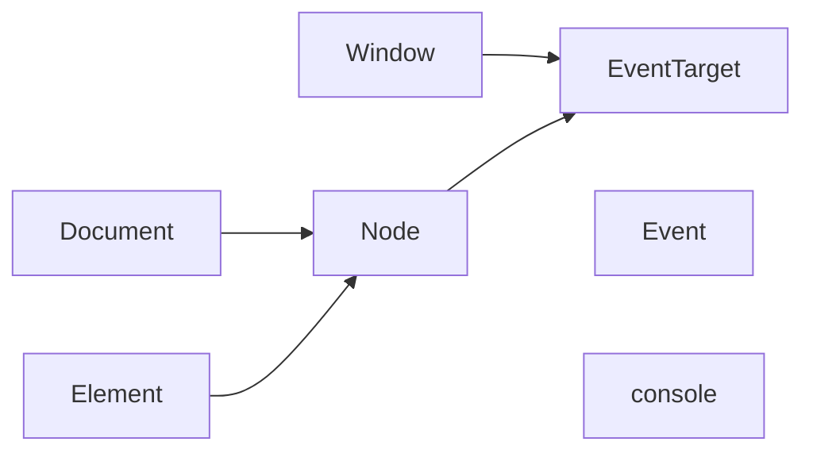

# Keywords

This file contains multiple set of keywords for CSS, HTML, JS and Vue in the listings below.
Duplicate keywords in different sets are possible (unless stated otherwise).

*No guarantees regarding completeness, correctness and up-to-dateness are made!*  
<sup>Last update: 2025-06-10</sup>


## CSS

The `!important` flag is included by default in this UDL (`important`).

<details>

<summary>CSS at-rules</summary>

### At-rules
At-rules are included by default in this UDL.
```
@annotation @character-variant @charset @color-profile @container @counter-style @font-face @font-feature-values @font-palette-values @import @keyframes @layer @media @namespace @ornaments @page @position-try @property @scope @starting-style @styleset @stylistic @supports @swash @view-transition
```
---

### Deprecated At-rules
Deprecated at-rules are not included by default.
```
@document
```
---

### Experimental At-rules
Experimental at-rules are not included by default.
```
@position-try
```

</details>

<details>

<summary>CSS value functions</summary>

### CSS value functions
CSS value functions are included by default in this UDL.
```
abs acos asin atan atan2 attr blur brightness calc circle clamp color-mix color conic-gradient contrast cos counter counters cross-fade cubic-bezier device-cmyk drop-shadow ellipse env exp fit-content grayscale hsl hue-rotate hwb hypot image-set image inset invert lab layer lch light-dark linear-gradient linear log matrix matrix3d max min minmax mod oklab oklch opacity paint path perspective polygon pow radial-gradient ray rect rem repeat repeat-conic-gradient repeat-linear-gradient repeat-radial-gradietn rgb rotate rotate3d rotateX rotateY rotateZ round saturate scale scale3d scaleX scaleY scaleZ sepia shape sign sin skew skewX skewY sqrt steps symbols tan translate translate3d translateX translateY translateZ url var xywh
```
---

### Deprecated CSS value functions
Deprecated CSS value functions are not included by default. `hsla` is not deprecated but not recommended.
```
-moz-image-rect hsla
```
---

### Experimental CSS value functions
Experimental CSS value functions are not included by default.
```
anchor-size anchor calc-size element palette-mix scroll view
```

</details>

<details>

<summary>CSS pseudo-classes</summary>

### CSS pseudo-classes
CSS pseudo classes are included by default in this UDL.
```
active any-link autofill buffering checked default defined dir disabled empty enabled first first-child first-of-type focus focus-visible focus-within fullscreen future has-slotted has host host-context hover in-range indeterminate invalid is lang last-child last-of-type left link modal muted not nth-child nth-last-child nth-last-of-type nth-of-type only-child only-of-type open optional out-of-range past paused picture-in-picture placeholder-shown playing popover-open read-only read-write required right root scope seeking stalled state target user-invalid user-valid visited volume-locked where
```
---

### Experimental CSS pseudo-classes
Experimental CSS pseudo-classes are not included by default.
```
blank current local-link target-current target-within
```
---

### Non-standard CSS pseudo-classes
Non-standard CSS pseudo-classes are not included by default.
```
-moz-broken -moz-drag-over -moz-first-node -moz-handler-blocked -moz-handler-crashed -moz-handler-disabled -moz-last-node -moz-loading -moz-locale-dir -moz-only-whitespace -moz-submit-invalid -moz-suppressed -moz-user-disabled -moz-window-inactive 
```

</details>

<details>

<summary>CSS pseudo-elements</summary>

### CSS pseudo-elements
CSS pseudo elements are included by default in this UDL.
```
after backdrop before cue details-content file-selector-button first-letter first-line grammar-error highlight marker part placeholder selection slotted spelling-error target-text view-transition view-transition-group view-transition-image-pair view-transition-new view-transition-old
```
---

### Experimental CSS pseudo-elements
Experimental CSS pseudo-elements are not included by default.
```
checkmark column picker-icon picker scroll-button scroll-marker scroll-marker-group 
```
---

### Non-standard CSS pseudo-elements
Non-standard CSS pseudo-elements are not included by default.
```
-moz-color-swatch -moz-focus-inner -moz-list-bullet -moz-list-number -moz-meter-bar -moz-progress-bar -moz-range-progress -moz-range-thumb -moz-range-track -webkit-inner-spin-button -webkit-meter-bar -webkit-meter-even-less-good-value -webkit-meter-inner-element -webkit-meter-optimum-value -webkit-meter-suboptimum-value -webkit-progress-bar -webkit-progress-inner-element -webkit-progress-value -webkit-scrollbar -webkit-search-cancel-button -webkit-search-results-button -webkit-slider-runnable-track -webkit-slider-thumb
```

</details>

<details>

<summary>CSS properties</summary>

### CSS properties
CSS properties are included by default in this UDL.
```
-webkit-text-fill-color -webkit-text-stroke -webkit-text-stroke-color -webkit-text-stroke-width accent-color align-content align-items align-self alignment-baseline all animation animation-composition animation-delay animation-direction animation-duration animation-fill-mode animation-iteration-count animation-name animation-play-state animation-timing-function appearance aspect-ratio backdrop-filter backface-visibility background background-attachment background-blend-mode background-clip background-color background-image background-origin background-position background-position-x background-position-y background-repeat background-size block-size border border-block border-block-color border-block-end border-block-end-color border-block-end-style border-block-end-width border-block-start border-block-start-color border-block-start-style border-block-start-width border-block-style border-block-width border-bottom border-bottom-color border-bottom-left-radius border-bottom-right-radius border-bottom-style border-bottom-width border-collapse border-color border-end-end-radius border-end-start-radius border-image border-image-outset border-image-repeat border-image-slice border-image-source border-image-width border-inline border-inline-color border-inline-end border-inline-end-color border-inline-end-style border-inline-end-width border-inline-start border-inline-start-color border-inline-start-style border-inline-start-width border-inline-style border-inline-width border-left border-left-color border-left-style border-left-width border-radius border-right border-right-color border-right-style border-right-width border-spacing border-start-end-radius border-start-start-radius border-style border-top border-top-color border-top-left-radius border-top-right-radius border-top-style border-top-width border-width bottom box-decoration-break box-shadow box-sizing break-after break-before break-inside caption-side caret-color clear clip-path clip-rule color color-interpolation color-interpolation-filters color-scheme column-count column-fill column-gap column-rule column-rule-color column-rule-style column-rule-width column-span column-width columns contain contain-intrinsic-block-size contain-intrinsic-height contain-intrinsic-inline-size contain-intrinsic-size contain-intrinsic-width container container-name container-type content content-visibility counter-increment counter-reset counter-set cursor cx cy d direction display dominant-baseline empty-cells fill fill-opacity fill-rule filter flex flex-basis flex-direction flex-flow flex-grow flex-shrink flex-wrap float flood-color flood-opacity font font-family font-feature-settings font-kerning font-language-override font-optical-sizing font-palette font-size font-size-adjust font-style font-synthesis font-synthesis-small-caps font-synthesis-style font-synthesis-weight font-variant font-variant-alternates font-variant-caps font-variant-east-asian font-variant-emoji font-variant-ligatures font-variant-numeric font-variant-position font-variation-settings font-weight forced-color-adjust gap grid grid-area grid-auto-columns grid-auto-flow grid-auto-rows grid-column grid-column-end grid-column-start grid-row grid-row-end grid-row-start grid-template grid-template-areas grid-template-columns grid-template-rows hanging-punctuation height hyphenate-character hyphenate-limit-chars hyphens image-orientation image-rendering initial-letter inline-size inset inset-block inset-block-end inset-block-start inset-inline inset-inline-end inset-inline-start isolation justify-content justify-items justify-self left letter-spacing lighting-color line-break line-clamp line-height list-style list-style-image list-style-position list-style-type margin margin-block margin-block-end margin-block-start margin-bottom margin-inline margin-inline-end margin-inline-start margin-left margin-right margin-top marker marker-end marker-mid marker-start mask mask-border mask-border-mode mask-border-outset mask-border-repeat mask-border-slice mask-border-source mask-border-width mask-clip mask-composite mask-image mask-mode mask-origin mask-position mask-repeat mask-size mask-type math-depth math-style max-block-size max-height max-inline-size max-width min-block-size min-height min-inline-size min-width mix-blend-mode object-fit object-position offset offset-anchor offset-distance offset-path offset-position offset-rotate opacity order orphans outline outline-color outline-offset outline-style outline-width overflow overflow-anchor overflow-block overflow-clip-margin overflow-inline overflow-wrap overflow-x overflow-y overscroll-behavior overscroll-behavior-block overscroll-behavior-inline overscroll-behavior-x overscroll-behavior-y padding padding-block padding-block-end padding-block-start padding-bottom padding-inline padding-inline-end padding-inline-start padding-left padding-right padding-top page paint-order perspective perspective-origin place-content place-items place-self pointer-events position print-color-adjust quotes r resize right rotate row-gap ruby-align ruby-position rx ry scale scroll-behavior scroll-margin scroll-margin-block scroll-margin-block-end scroll-margin-block-start scroll-margin-bottom scroll-margin-inline scroll-margin-inline-end scroll-margin-inline-start scroll-margin-left scroll-margin-right scroll-margin-top scroll-padding scroll-padding-block scroll-padding-block-end scroll-padding-block-start scroll-padding-bottom scroll-padding-inline scroll-padding-inline-end scroll-padding-inline-start scroll-padding-left scroll-padding-right scroll-padding-top scroll-snap-align scroll-snap-stop scroll-snap-type scrollbar-color scrollbar-gutter scrollbar-width shape-image-threshold shape-margin shape-outside shape-rendering stop-color stop-opacity stroke stroke-dasharray stroke-dashoffset stroke-linecap stroke-linejoin stroke-miterlimit stroke-opacity stroke-width tab-size table-layout text-align text-align-last text-anchor text-box text-box-edge text-box-trim text-combine-upright text-decoration text-decoration-color text-decoration-line text-decoration-skip-ink text-decoration-style text-decoration-thickness text-emphasis text-emphasis-color text-emphasis-position text-emphasis-style text-indent text-justify text-orientation text-overflow text-rendering text-shadow text-transform text-underline-offset text-underline-position text-wrap text-wrap-mode text-wrap-style top touch-action transform transform-box transform-origin transform-style transition transition-behavior transition-delay transition-duration transition-property transition-timing-function translate unicode-bidi user-select vector-effect vertical-align view-transition-class view-transition-name visibility white-space white-space-collapse widows width will-change word-break word-spacing writing-mode x y z-index zoom
```
---

### Deprecated CSS properties
Deprecated CSS properties are not included by default.
```
clip font-stretch page-break-after page-break-before page-break-inside
```
---

### Experimental CSS properties
Experimental CSS properties are not included by default.
```
anchor-name animation-range animation-range-end animation-range-start animation-timeline field-sizing font-synthesis-position image-resolution interpolate-size line-height-step margin-trim math-shift overlay position-anchor position-area position-try position-try-fallbacks position-try-order position-visibility reading-flow reading-order scroll-marker-group scroll-timeline scroll-timeline-axis scroll-timeline-name speak-as text-decoration-skip text-size-adjust text-spacing-trim timeline-scope view-timeline view-timeline-axis view-timeline-inset view-timeline-name 
```
---

### Non-standard CSS properties
Non-standard CSS properties are not included by default.
```
-moz-float-edge -moz-force-broken-image-icon -moz-image-region -moz-orient -moz-user-focus -moz-user-input -webkit-border-before -webkit-box-reflect -webkit-mask-box-image -webkit-mask-composite -webkit-mask-position-x -webkit-mask-position-y -webkit-mask-repeat-x -webkit-mask-repeat-y -webkit-tap-highlight-color -webkit-text-security -webkit-touch-callout  box-align box-direction box-flex box-flex-group box-lines box-ordinal-group box-orient box-pack font-smooth user-modify 
```

</details>


## HTML

<details>

<summary>HTML tags</summary>

### HTML tags
Standard HTML tags are included by this UDL.
```
doctype a abbr address area article aside audio b base bdi bdo blockquote body br button canvas caption cite code col colgroup data datalist dd del details dfn dialog div dl dt em embed fieldset figcaption figure footer form h1 h2 h3 h4 h5 h6 head header hgroup hr html i iframe img input ins kbd label legend li link main map mark menu meta meter nav noscript object ol optgroup option output p param picture pre progress q rp rt ruby s samp script search section select slot small source span strong style sub summary sup table tbody td template textarea tfoot th thead time title tr track u ul var video wbr
```
---

### HTML deprecated tags
Deprecated HTML tags are not included by default.
```
acronym big center dir font frame frameset marquee nobr noembed noframes param plaintext rb rtc strike tt xmp
```
---

### HTML experimental tags
Experimental HTML tags are not included by default.
```
fencedframe selectedcontent
```

</details>

<details>

<summary>HTML attributes</summary>

### HTML global attributes
Global HTML attributes used by this UDL where `data-*` has been omitted.
Highlighting custom `data-*`-attributes is possible using prefix mode but requires the use of a separate keyword-set.

```
accesskey autocapitalize autocorrect autofocus class contenteditable dir draggable enterkeyhint exportparts hidden id inert inputmode is itemid itemprop itemref itemscope itemtype lang nonce part popover slot spellcheck style tabindex title translate writingsuggestions
```
---

### HTML experimental global attributes
Experimental global attributes are not included by default.
```
anchor virtualkeyboardpolicy
```
---

### HTML attributes
Standard HTML attributes are included by this UDL.
```
abbr accept accept-charset accesskey action allow alt as async autocomplete autoplay blocking capture charset checked cite cols colspan command commandfor content controls controlslist coords crossorigin data datetime decoding default defer dirname disabled disablepictureinpicture disableremoteplayback download enctype elementtiming fetchpriority filename for form formaction formenctype formmethod formnovalidate formtarget headers height high href hreflang http-equiv imagesizes imagesrcset integrity ismap kind label loading list loop low max maxlength minlength media method min multiple muted name nomodule novalidate open optimum pattern ping placeholder playsinline popovertarget popovertargetaction poster preload readonly referrerpolicy rel required reversed rows rowspan sandbox scope selected shadowrootmode shadowrootclonable shadowrootdelegatesfocus shape size sizes span src srcdoc srclang srcset start step target type usemap value width wrap xmlns
```
---

### HTML deprecated attributes
Attributes are only listed here, if there is no element for which their use isn't deprecated.
Some attributes like `type`, albeit being deprecated for some elements, are not listed as deprecated because other elements may use them.
Keywords here are not included by default.
```
align alink allowfullscreen allowpaymentrequest attributionsrc archive axis background behavior bgcolor border bottommargin cellpadding cellspacing char charoff classid clear codebase codetype color compact declare direction face frame frameborder hspace intrinsicsize language leftmargin link longdesc marginheight marginwidth noresize noshade onmousewheel profile rev rightmargin rules scoped scrollamount scrolldelay scrolling shadowrootserializable standby summary topmargin truespeed valign valuetype version vlink vspace
```
---

### HTML event attributes
The usage of event handler content attributes is discouraged.
They are therefore not included by default in this UDL.
```
onabort onafterprint onbeforeprint onbeforeunload onblur oncanplay oncanplaythrough onchange onclick oncontextmenu oncopy oncuechange oncut ondblclick ondrag ondragend ondragenter ondragleave ondragover ondragstart ondrop ondurationchange onemptied onended onerror onfocus onhashchange oninput oninvalid onkeydown onkeypress onkeyup onload onloadeddata onloadedmetadata onloadstart onmessage onmousedown onmousemove onmouseout onmouseover onmouseup onoffline ononline onpagehide onpageshow onpaste onpause onplay onplaying onpopstate onprogress onratechange onreset onresize onscroll onsearch onseeked onseeking onselect onstalled onstorage onsubmit onsuspend ontimeupdate ontoggle onunload onvolumechange onwaiting onwheel
```
---

### HTML experimental attributes
Experimental HTML attributes are not included by default.
```
attributionsrc browsingtopics closedby credentialless csp rev
```

</details>


## JavaScript

<details>

<summary>JavaScript core</summary>

### JavaScript Reserved words & Literals
Reserved words and literals are included by default in this UDL.

```
break case catch class const continue debugger default delete do else export extends false finally for function if import in instanceof let new null return static super switch this throw true try typeof var void while with yield
```
---
### JavaScript Identifiers with special meanings
Identifiers with special meanings are included by default in this UDL.
`eval` is omitted since it is also part of build-in function properties.

```
as async from of
```
```
arguments prototype
```
```
constructor get set
```
---

### JavaScript Future reserved words
Future reserved words are included by default in this UDL.

```
enum implements interface package private protected public
```
---

### JavaScript Future reserved words in older standards
Future reserved words in older standards are not included by default.

```
abstract boolean byte char double final float goto int long native short synchronized throws transient volatile 
```

</details>

<details>

<summary>JavaScript built-in objects</summary>

### JavaScript Value properties
Value properties are included by default in this UDL.

```
globalThis Infinity NaN undefined
```
---
### JavaScript Function properties
Function properties are included by default in this UDL.

```
eval isFinite isNaN parseFloat parseInt decodeURI decodeURIComponent encodeURI encodeURIComponent
```
---

### JavaScript Deprecated function properties
Deprecated function properties are not included by default.

```
escape unescape
```
---

### JavaScript Built-in objects
Built-in objects are included by default in this UDL.

```
AggregateError Array ArrayBuffer AsyncFunction AsyncGenerator AsyncGeneratorFunction AsyncIterator Atomics BigInt BigInt64Array BigUint64Array Boolean DataView Date Error EvalError FinalizationRegistry Float16Array Float32Array Float64Array Function Generator GeneratorFunction Int16Array Int32Array Int8Array Intl Iterator JSON Map Math Number Object Promise Proxy RangeError ReferenceError Reflect RegExp Set SharedArrayBuffer String Symbol SyntaxError Temporal TypeError TypedArray URIError Uint16Array Uint32Array Uint8Array Uint8ClampedArray WeakMap WeakRef WeakSet
```
---

### JavaScript Non-standard built-in objects
Non-standdard built-in objects are not included by default.

```
InternalError
```

</details>

<details>

<summary>JavaScript Object</summary>

### JavaScript Object static methods
Object static methods are included by default in this UDL.

```
assign create defineProperties defineProperty entries freeze fromEntries getOwnPropertyDescriptor getOwnPropertyDescriptors getOwnPropertyNames getOwnPropertySymbols getPrototypeOf groupBy hasOwn is isExtensible isFrozen isSealed keys preventExtensions seal setPrototypeOf values
```
---
### JavaScript Object instance methods
Object instance methods properties are included by default in this UDL.

```
hasOwnProperty isPrototypeOf propertyIsEnumerable toLocaleString toString valueOf
```
---

### JavaScript Deprecated object properties
Deprecated object properties are not included by default.

```
__defineGetter__ __defineSetter__ __lookupGetter__ __lookupSetter__ __proto__ 
```

</details>

<details>

<summary>JavaScript Function</summary>

### JavaScript Function instance methods
Function methods are included by default in this UDL.

```
apply bind call toString
```
---

### JavaScript Function instance properties
Function properties are not included by default in this UDL.

```
length name
```
---

### JavaScript Non-standard Function instance properties
Non-standard Function instance properties are not included by default.

```
caller displayName
```

</details>

<details>

<summary>JavaScript Boolean</summary>

### JavaScript Boolean instance methods
Boolean methods are included by default in this UDL.

```
toString valueOf
```

</details>

<details>

<summary>JavaScript Symbol</summary>

### JavaScript Symbol instance methods
Symbol methods are included by default in this UDL.

```
toString valueOf
```
---

### JavaScript Symbol instance properties
Symbol properties are included by default in this UDL.

```
description
```
---

### JavaScript Symbol static methods
Static Symbol methods are included by default in this UDL.

```
for keyFor
```
---

### JavaScript Symbol static properties
Static Symbol properties are included by default in this UDL.

```
asyncIterator hasInstance isConcatSpreadable iterator match matchAll replace search species split toPrimitive toStringTag unscopables
```

</details>

<details>

<summary>JavaScript Error</summary>

### JavaScript Error instance methods
Error methods are included by default in this UDL.

```
toString
```
---

### JavaScript Error instance properties
Error properties are included by default in this UDL.

```
cause message name
```
---

### JavaScript Non-standard Error instance properties
Static Error properties are not included by default.

```
columnNumber fileName lineNumber stack
```
---

### JavaScript Error static methods
Static Error methods are included by default in this UDL.

```
captureStackTrace isError
```
---

### JavaScript Non-standard Error static properties
Static non-standard Error properties are not included by default.

```
stackTraceLimit
```

</details>

<details>

<summary>JavaScript Number</summary>

### JavaScript Number instance methods
Number methods are included by default in this UDL.

```
toExponential toFixed toLocaleString toPrecision toString valueOf
```
---

### JavaScript Number static methods
Static Number methods are included by default in this UDL.

```
isFinite isInteger isNaN isSafeInteger parseFloat parseInt
```
---

### JavaScript Number static properties
Static Number properties are included by default in this UDL.

```
EPSILON MAX_SAFE_INTEGER MAX_VALUE MIN_SAFE_INTEGER MIN_VALUE NaN NEGATIVE_INFINITY POSITIVE_INFINITY
```

</details>

<details>

<summary>JavaScript BigInt</summary>

### JavaScript BigInt instance methods
BigInt methods are included by default in this UDL.

```
toLocaleString toString valueOf
```
---

### JavaScript BigInt static methods
Static BigInt methods are included by default in this UDL.

```
asIntN asUintN
```

</details>

<details>

<summary>JavaScript Math</summary>

### JavaScript Math static methods
Static Math methods are included by default in this UDL.

```
abs acos acosh asin asinh atan atan2 atanh cbrt ceil clz32 cos cosh exp expm1 f16round floor fround hypot imul log log1p log2 log10 max min pow random round sign sin sinh sqrt sumPrecise tan tanh trunc
```
---

### JavaScript Math static properties
Static Math properties are included by default in this UDL.

```
E LN2 LN10 LOG2E LOG10E PI SQRT1_2 SQRT2
```

</details>

<details>

<summary>JavaScript Date</summary>

### JavaScript Date instance methods
Date methods are included by default in this UDL.

```
getDate getDay getFullYear getHours getMilliseconds getMinutes getMonth getSeconds getTime getTimezoneOffset getUTCDate getUTCDay getUTCFullYear getUTCHours getUTCMilliseconds getUTCMinutes getUTCMonth getUTCSeconds setDate setFullYear setHours setMilliseconds setMinutes setMonth setSeconds setTime setUTCDate setUTCFullYear setUTCHours setUTCMilliseconds setUTCMinutes setUTCMonth setUTCSeconds toDateString toISOString toJSON toLocaleDateString toLocaleString toLocaleTimeString toString toTimeString toUTCString valueOf
```
---

### JavaScript Deprecated Date instance methods
Deprecated Date methods are not included by default .

```
getYear setYear
```
---

### JavaScript Experimental Date instance methods
Experimental Date methods are not included by default .

```
toTemporalInstant
```
---

### JavaScript Date static methods
Static Date methods are included by default in this UDL.

```
now parse UTC
```

</details>

<details>

<summary>JavaScript String</summary>

### JavaScript String instance methods
String methods are included by default in this UDL.

```
at charAt charCodeAt codePointAt concat endsWith includes indexOf isWellFormed lastIndexOf localeCompare match matchAll normalize padEnd padStart repeat replace replaceAll search slice split startsWith substring toLocaleLowerCase toLocaleUpperCase toLowerCase toString toUpperCase toWellFormed trim trimEnd trimStart valueOf
```
---

### JavaScript Deprecated String instance methods
Deprecated String methods are not included by default.

```
anchor big blink bold fixed fontcolor fontsize italics link small strike sub substr sup
```
---

### JavaScript String instance properties
String properties are included by default in this UDL.

```
length
```
---

### JavaScript String static methods
Static String methods are included by default in this UDL.

```
fromCharCode fromCodePoint raw
```

</details>

<details>

<summary>JavaScript RegExp</summary>

### JavaScript RegExp instance methods
RegExp methods are included by default in this UDL.

```
exec test toString
```
---

### JavaScript Deprecated RegExp instance methods
Deprecated RegExp methods are not included by default.

```
compile
```
---

### JavaScript RegExp instance properties
RegExp properties are included by default in this UDL.

```
lastIndex dotAll flags global hasIndices ignoreCase multiline source sticky unicode unicodeSets
```
---

### JavaScript RegExp static methods
Static RegExp methods are included by default in this UDL.

```
escape
```
---

### JavaScript Deprecated RegExp static properties
Deprecated static RegExp properties are not included by default.

```
$& $' $+ $1 $2 $3 $4 $5 $6 $7 $8 $9 $_ $` input lastMatch lastParen leftContext rightContext
```

</details>

<details>

<summary>JavaScript Map</summary>

### JavaScript Map instance methods
Map methods are included by default in this UDL.

```
clear delete entries forEach get has keys set values
```
---

### JavaScript Map instance properties
Map properties are included by default in this UDL.

```
size
```
---

### JavaScript RegMapExp static methods
Static Map methods are included by default in this UDL.

```
groupBy
```

</details>

<details>

<summary>JavaScript Set</summary>

### JavaScript Set instance methods
Set methods are included by default in this UDL.

```
add clear delete difference entries forEach has intersection isDisjointFrom isSupersetOf keys symmetricDifference union values
```
---

### JavaScript Set instance properties
Set properties are included by default in this UDL.

```
size
```

</details>

<details>

<summary>JavaScript WeakMap</summary>

### JavaScript WeakMap instance methods
WeakMap methods are included by default in this UDL.

```
delete get has set
```

</details>

<details>

<summary>JavaScript WeakSet</summary>

### JavaScript WeakSet instance methods
WeakSet methods are included by default in this UDL.

```
add delete has
```

</details>

<details>

<summary>JavaScript Array</summary>

### JavaScript Array instance methods
Array methods are included by default in this UDL.

```
at concat copyWithin entries every fill filter find findIndex findLast findLastIndex flat flatMap forEach includes indexOf join keys lastIndexOf map pop push reduce reduceRight reverse shift slice some sort splice toLocaleString toReversed toSorted toSpliced toString unshift values with
```
---

### JavaScript Array instance properties
Array properties are included by default in this UDL.

```
length
```
---

### JavaScript Array static methods
Static Array methods are included by default in this UDL.

```
from fromAsync isArray of
```

</details>

<details>

<summary>JavaScript TypedArray</summary>

The objects `BigInt64Array`, `BigUint64Array`, `Float16Array`, `Float32Array`, `Float64Array`, `Int8Array`, `Int16Array`, `Int32Array`, `Uint8Array`, `Uint8ClampedArray`, `Uint16Array`, `Uint32Array` extend from `TypedArray`. However, only `UInt8Array` has additional properties. 

### JavaScript TypedArray instance methods
TypedArray methods are included by default in this UDL.

```
at copyWithin entries every fill filter find findIndex findLast findLastIndex forEach includes indexOf join keys lastIndexOf map reduce reduceRight reverse set slice some sort subarray toLocaleString toReversed toSorted toString values with
```
---

### JavaScript TypedArray instance properties
TypedArray properties are included by default in this UDL.

```
buffer byteLength byteOffset length
```
---

### JavaScript TypedArray static methods
Static TypedArray methods are included by default in this UDL.

```
from of
```
---

### JavaScript TypedArray static properties
Static TypedArray properties are included by default in this UDL.

```
BYTES_PER_ELEMENT
```

</details>

<details>

<summary>JavaScript UInt8Array</summary>

### JavaScript UInt8Array instance methods
UInt8Array methods are included by default in this UDL.

```
setFromBase64 setFromHex toBase64 toHex
```
---

### JavaScript UInt8Array static instance methods
Static UInt8Array methods are included by default in this UDL.

```
fromBase64 fromHex
```

</details>

<details>

<summary>JavaScript ArrayBuffer</summary> 

### JavaScript ArrayBuffer instance methods
ArrayBuffer methods are included by default in this UDL.

```
resize slice transfer transferToFixedLength
```
---

### JavaScript ArrayBuffer instance properties
ArrayBuffer properties are included by default in this UDL.

```
byteLength detached maxByteLength resizable
```
---

### JavaScript ArrayBuffer static methods
Static ArrayBuffer methods are included by default in this UDL.

```
isView
```

</details>

<details>

<summary>JavaScript SharedArrayBuffer</summary> 

### JavaScript SharedArrayBuffer instance methods
SharedArrayBuffer methods are included by default in this UDL.

```
grow slice
```
---

### JavaScript SharedArrayBuffer instance properties
SharedArrayBuffer properties are included by default in this UDL.

```
byteLength growable maxByteLength
```

</details>

<details>

<summary>JavaScript DataView</summary> 

### JavaScript DataView instance methods
DataView methods are included by default in this UDL.

```
getBigInt64 getBigUint64 getFloat16 getFloat32 getFloat64 getInt8 getInt16 getInt32 getUint8 getUint16 getUint32 setBigInt64 setBigUint64 setFloat16 setFloat32 setFloat64 setInt8 setInt16 setInt32 setUint8 setUint16 setUint32
```
---

### JavaScript DataView instance properties
DataView properties are included by default in this UDL.

```
buffer byteLength byteOffset
```

</details>

<details>

<summary>JavaScript Atomics</summary> 

### JavaScript Atomics static methods
Static Atomics methods are included by default in this UDL.

```
add and compareExchange exchange isLockFree load notify or pause store sub wait waitAsync xor
```

</details>

<details>

<summary>JavaScript JSON</summary> 

### JavaScript JSON static methods
Static JSON methods are included by default in this UDL.

```
isRawJSON parse rawJSON stringify
```

</details>

<details>

<summary>JavaScript WeakRef</summary> 

### JavaScript WeakRef instance methods
WeakRef methods are included by default in this UDL.

```
deref
```

</details>

<details>

<summary>JavaScript FinalizationRegistry</summary> 

### JavaScript FinalizationRegistry instance methods
FinalizationRegistry methods are included by default in this UDL.

```
register unregister
```

</details>

<details>

<summary>JavaScript Iterator</summary> 

### JavaScript Iterator instance methods
Iterator methods are included by default in this UDL.

```
drop every filter find flatMap forEach map reduce some take toArray
```
---

### JavaScript Iterator static methods
Static Iterator methods are included by default in this UDL.

```
from
```

</details>

<details>

<summary>JavaScript Promise</summary> 

### JavaScript Promise instance methods
Promise methods are included by default in this UDL.

```
catch finally then
```
---

### JavaScript Promise static methods
Static Promise methods are included by default in this UDL.

```
all allSettled any race reject resolve try withResolvers
```

</details>

<details>

<summary>JavaScript Generator/AsyncGenerator</summary> 

### JavaScript Generator instance methods
Generator methods are included by default in this UDL.

```
next return throw
```

</details>

<details>

<summary>JavaScript Reflect</summary> 

### JavaScript Reflect static methods
Static Reflect methods are included by default in this UDL.

```
apply construct defineProperty deleteProperty get getOwnPropertyDescriptor getPrototypeOf has isExtensible ownKeys preventExtensions set setPrototypeOf
```

</details>

<details>

<summary>JavaScript Proxy</summary> 

### JavaScript Proxy static methods
Static Proxy methods are included by default in this UDL.

```
revocable
```

</details>


## Javascript - WebAPIs
WebAPIs extends the core JavaScript (ECMAScript).
The keywords listed here cover a few elements of said APIs:
```
console Document document Element Event EventTarget Node Window window
```

### Inheritance


<details>

<summary>JavaScript console</summary> 

### JavaScript console static methods
Static console methods are included by default in this UDL.
```
assert clear count countReset debug dir dirxml error group groupCollapsed groupEnd info log table time timeEnd timeLog trace warn
```
---

### JavaScript console static non-standard methods
Static non-standard console methods are not included by default.
```
profile profileEnd timeStamp
```

</details>

<details>

<summary>JavaScript EventTarget</summary> 

### JavaScript EventTarget instance methods
EventTarget methods are included by default in this UDL.
```
addEventListener dispatchEvent removeEventListener
```

</details>

<details>

<summary>JavaScript window</summary> 

### JavaScript window instance methods
Window methods are included by default in this UDL.
```
alert atob btoa cancelAnimationFrame cancelIdleCallback clearInterval clearTimeout close confirm createImageBitmap fetch find focus getComputedStyle getSelection matchMedia moveBy moveTo open postMessage print prompt queueMicrotask reportError requestAnimationFrame requestIdleCallback resizeBy resizeTo scroll scrollBy scrollTo setInterval setTimeout stop structuredClone
```
---

### JavaScript Deprecated window instance methods
Deprecated window methods are not included by default.
```
blur captureEvents clearImmediate releaseEvents requestFileSystem setImmediate setResizable webkitConvertPointFromNodeToPage webkitConvertPointFromPageToNode
```
---

### JavaScript Experimental window instance methods
Experimental window methods are not included by default.
```
fetchLater getScreenDetails queryLocalFonts showDirectoryPicker showOpenFilePicker showSaveFilePicker
```
---

### JavaScript Non-standard window instance methods
Non-standard window methods are not included by default.
```
clearImmediate dump getDefaultComputedStyle requestFileSystem scrollByLines scrollByPages setImmediate setResizable sizeToContent webkitConvertPointFromNodeToPage
```
---

### JavaScript window instance properties
Window properties are included by default in this UDL.
```
caches clientInformation closed cookieStore crossOriginIsolated crypto customElements devicePixelRatio document frameElement frames history indexedDB innerHeight innerWidth isSecureContext length localStorage location locationbar menubar name navigator opener origin originAgentCluster outerHeight outerWidth parent performance personalbar scheduler screen screenLeft screenTop screenX screenY scrollbars scrollX scrollY self sessionStorage speechSynthesis statusbar toolbar top trustedTypes visualViewport window
```
---

### JavaScript Deprecated window properties
Deprecated window properties are not included by default.
```
event external orientation status
```
---

### JavaScript Experimental window properties
Experimental window properties are not included by default.
```
credentialless documentPictureInPicture fence launchQueue navigation sharedStorage
```
---

### JavaScript Non-standard window properties
Non-standard window properties are not included by default.
```
fullScreen mozInnerScreenX mozInnerScreenY scrollMaxX scrollMaxY
```
---

### JavaScript window events
Window events are not included by default.
```
onafterprint onappinstalled onbeforeinstallprompt onbeforeprint onbeforeunload onblur ondevicemotion ondeviceorientation ondeviceorientationabsolute onerror onfocus ongamepadconnected ongamepaddisconnected onhashchange onlanguagechange onload onmessage onmessageerror onoffline ononline onpagehide onpagereveal onpageshow onpageswap onpopstate onrejectionhandled onresize onstorage onunhandledrejection
```
---

### JavaScript Deprecated window events
Deprecated window events are not included by default.
```
onorientationchange onunload onvrdisplayactivate onvrdisplayconnect onvrdisplaydeactivate onvrdisplaydisconnect onvrdisplaypresentchange
```
---

### JavaScript Experimental window events
Experimental window events are not included by default.
```
onscrollsnapchange onscrollsnapchanging
```
---

### JavaScript Non-standard window events
Non-standard window events are not included by default.
```
onvrdisplayactivate onvrdisplayconnect onvrdisplaydeactivate onvrdisplaydisconnect onvrdisplaypresentchange
```

</details>

<details>

<summary>JavaScript Node</summary> 

### JavaScript Node instance methods
Node methods are included by default in this UDL.
```
baseURI childNodes firstChild isConnected lastChild nextSibling nodeName nodeType nodeValue ownerDocument parentElement parentNode previousSibling textContent
```
---

### JavaScript Node instance properties
Node properties are included by default in this UDL.
```
appendChild cloneNode compareDocumentPosition contains getRootNode hasChildNodes insertBefore isDefaultNamespace isEqualNode isSameNode lookupNamespaceURI lookupPrefix normalize removeChild replaceChild
```
---

### JavaScript Node events
Node events are included by default in this UDL.
```
onselectstart
```

</details>

<details>

<summary>JavaScript Document</summary> 

### JavaScript Document instance methods
Document methods are included by default in this UDL.
```
adoptNode append caretPositionFromPoint close createAttribute createAttributeNS createCDATASection createComment createDocumentFragment createElement createElementNS createExpression createNodeIterator createProcessingInstruction createRange createTextNode createTreeWalker elementFromPoint elementsFromPoint evaluate exitFullscreen exitPictureInPicture exitPointerLock getAnimations getElementById getElementsByClassName getElementsByName getElementsByTagName getElementsByTagNameNS getSelection hasFocus hasStorageAccess hasUnpartitionedCookieAccess importNode open prepend querySelector querySelectorAll replaceChildren requestStorageAccess startViewTransition writeln
```
---

### JavaScript Deprecated Document instance methods
Deprecated Document methods are not included by default.
```
clear createEvent createNSResolver createTouch createTouchList enableStyleSheetsForSet execCommand queryCommandEnabled queryCommandState queryCommandSupported write
```
---

### JavaScript Experimental Document instance methods
Experimental Document methods are not included by default.
```
browsingTopics moveBefore requestStorageAccessFor
```
---

### JavaScript Non-standard Document instance methods
Non-standard Document methods are not included by default.
```
browsingTopics caretRangeFromPoint createTouch createTouchList enableStyleSheetsForSet mozSetImageElement queryCommandEnabled queryCommandState queryCommandSupported releaseCapture
```
---

### JavaScript Document instance properties
Document properties are included by default in this UDL.
```
activeElement adoptedStyleSheets body characterSet childElementCount children compatMode contentType cookie currentScript defaultView designMode dir doctype documentElement documentURI embeds firstElementChild fonts forms fragmentDirective fullscreenElement fullscreenEnabled head hidden images implementation lastElementChild lastModified links location pictureInPictureElement pictureInPictureEnabled plugins pointerLockElement readyState referrer scripts scrollingElement styleSheets timeline title URL visibilityState xmlVersion
```
---

### JavaScript Deprecated Document instance properties
Deprecated Document properties are not included by default.
```
alinkColor all anchors applets bgColor domain fgColor fullscreen lastStyleSheetSet linkColor preferredStyleSheetSet rootElement selectedStyleSheetSet styleSheetSets vlinkColor xmlEncoding
```
---

### JavaScript Experimental Document instance properties
Experimental Document properties are not included by default.
```
featurePolicy prerendering
```
---

### JavaScript Non-standard Document instance properties
Non-standard Document properties are not included by default.
```
lastStyleSheetSet preferredStyleSheetSet selectedStyleSheetSet styleSheetSets
```
---

### JavaScript Document static methods
Static Document methods are included by default in this UDL.
```
parseHTML parseHTMLUnsafe
```
---

### JavaScript Document events
Document events are included by default in this UDL.
```
onfullscreenchange onfullscreenerror onpointerlockchange onpointerlockerror onreadystatechange onscroll onscrollend onsecuritypolicyviolation onselectionchange onvisibilitychange
```
---

### JavaScript Deprecated Document events
Deprecated Document events are not included by default.
```
onafterscriptexecute onbeforescriptexecute
```
---

### JavaScript Experimental Document events
Experimental Document events are not included by default.
```
onprerenderingchange onscrollsnapchange onscrollsnapchanging
```
---

### JavaScript Non-standard Document events
Non-standard Document events are not included by default.
```
onafterscriptexecute onbeforescriptexecute
```

</details>

<details>

<summary>JavaScript Event</summary> 

### JavaScript Event instance methods
Event methods are included by default in this UDL.
```
composedPath preventDefault stopImmediatePropagation stopPropagation
```
---

### JavaScript Deprecated Event instance methods
Deprecated Event methods are not included by default.
```
initEvent
```
---

### JavaScript Event instance properties
Event properties are included by default in this UDL.
```
bubbles cancelable composed currentTarget defaultPrevented eventPhase isTrusted target timeStamp type
```
---

### JavaScript Deprecated Event instance properties
Deprecated Event properties are not included by default.
```
cancelBubble returnValue srcElement
```
---

### JavaScript Non-standard Event instance properties
Non-standard Event properties are not included by default.
```
explicitOriginalTarget originalTarget
```

</details>

<details>

<summary>JavaScript Element</summary> 

### JavaScript Element instance methods
Element methods are included by default in this UDL.
```
after animate append attachShadow before checkVisibility closest computedStyleMap getAnimations getAttribute getAttributeNames getAttributeNode getAttributeNodeNS getAttributeNS getBoundingClientRect getClientRects getElementsByClassName getElementsByTagName getElementsByTagNameNS getHTML hasAttribute hasAttributeNS hasAttributes hasPointerCapture insertAdjacentElement insertAdjacentHTML insertAdjacentText matches prepend querySelector querySelectorAll releasePointerCapture remove removeAttribute removeAttributeNode removeAttributeNS replaceChildren replaceWith requestFullscreen requestPointerLock scroll scrollBy scrollIntoView scrollTo setAttribute setAttributeNode setAttributeNodeNS setAttributeNS setHTMLUnsafe setPointerCapture toggleAttribute
```
---

### JavaScript Deprecated Element instance methods
Deprecated Element methods are not included by default.
```
setCapture
```
---

### JavaScript Experimental Element instance methods
Experimental Element methods are not included by default.
```
moveBefore setHTML
```
---

### JavaScript Non-standard Element instance methods
Non-standard Element methods are not included by default.
```
scrollIntoViewIfNeeded setCapture
```
---

### JavaScript Element instance properties
Element properties are included by default in this UDL.
```
ariaActiveDescendantElement ariaAtomic ariaAutoComplete ariaBrailleLabel ariaBrailleRoleDescription ariaBusy ariaChecked ariaColCount ariaColIndex ariaColIndexText ariaColSpan ariaControlsElements ariaCurrent ariaDescribedByElements ariaDescription ariaDetailsElements ariaDisabled ariaErrorMessageElements ariaExpanded ariaFlowToElements ariaHasPopup ariaHidden ariaInvalid ariaKeyShortcuts ariaLabel ariaLabelledByElements ariaLevel ariaLive ariaModal ariaMultiLine ariaMultiSelectable ariaOrientation ariaOwnsElements ariaPlaceholder ariaPosInSet ariaPressed ariaReadOnly ariaRequired ariaRoleDescription ariaRowCount ariaRowIndex ariaRowIndexText ariaRowSpan ariaSelected ariaSetSize ariaSort ariaValueMax ariaValueMin ariaValueNow ariaValueText assignedSlot attributes childElementCount children classList className clientHeight clientLeft clientTop clientWidth currentCSSZoom firstElementChild id innerHTML lastElementChild localName namespaceURI nextElementSibling outerHTML part prefix previousElementSibling role scrollHeight scrollLeft scrollTop scrollWidth shadowRoot slot tagName
```
---

### JavaScript Experimental Element instance properties
Experimental Element properties are not included by default.
```
elementTiming
```
---

### JavaScript Non-standard Element instance properties
Non-standard Element properties are not included by default.
```
ariaRelevant scrollLeftMax scrollTopMax
```
---

### JavaScript Element events
Element events are included by default in this UDL.
```
onanimationcancel onanimationend onanimationiteration onanimationstart onauxclick onbeforeinput onbeforematch onblur onclick oncompositionend oncompositionstart oncompositionupdate oncontentvisibilityautostatechange oncontextmenu oncopy oncut ondblclick onfocus onfocusin onfocusout onfullscreenchange onfullscreenerror ongotpointercapture oninput onkeydown onkeyup onlostpointercapture onmousedown onmouseenter onmouseleave onmousemove onmouseout onmouseover onmouseup onpaste onpointercancel onpointerdown onpointerenter onpointerleave onpointermove onpointerout onpointerover onpointerrawupdate onpointerup onscroll onscrollend onsecuritypolicyviolation ontouchcancel ontouchend ontouchmove ontouchstart ontransitioncancel ontransitionend ontransitionrun ontransitionstart onwheel
```
---

### JavaScript Deprecated Element events
Deprecated Element events are not included by default.
```
onafterscriptexecute onbeforescriptexecute onDOMActivate onDOMMouseScroll onkeypress onmousewheel onMozMousePixelScroll
```
---

### JavaScript Experimental Element events
Experimental Element events are not included by default.
```
onbeforexrselect onscrollsnapchange onscrollsnapchanging
```
---

### JavaScript Non-standard Element events
Non-standard Element events are not included by default.
```
onafterscriptexecute onbeforescriptexecute onDOMMouseScroll ongesturechange ongestureend ongesturestart onmousewheel onMozMousePixelScroll onwebkitmouseforcechanged onwebkitmouseforcedown onwebkitmouseforceup onwebkitmouseforcewillbegin
```

</details>


## Vue

<details>

<summary>Vue Built-ins</summary>

### Vue Directives
Vue directives are included.
Shorthands are excluded due to the overlap with Operators 1 and requiring prefix-mode.
```
v-bind v-cloak v-else v-else-if v-for v-html v-if v-memo v-model v-on v-once v-pre v-show v-slot v-text
```
---

### Vue Modifiers
Vue Modifiers are included by default.
```
attr camel capture lazy left middle number once passive prevent prop right self stop trim
```
---

### Vue Special Attributes
Vue Special Attributes are included by default.
```
is key ref
```
---

### Vue Components & Special Elements
Vue Components & Special Elements are included by default.
```
component KeepAlive slot Suspense Teleport template Transition TransitionGroup
```
---

### Vue v-on event shorthands
Vue v-on event shorthands are included by default.
This list is a modified copy of the [HTML event attributes](#html-event-attributes).
```
@abort @afterprint @beforeprint @beforeunload @blur @canplay @canplaythrough @change @click @contextmenu @copy @cuechange @cut @dblclick @drag @dragend @dragenter @dragleave @dragover @dragstart @drop @durationchange @emptied @ended @error @focus @hashchange @input @invalid @keydown @keypress @keyup @load @loadeddata @loadedmetadata @loadstart @message @mousedown @mousemove @mouseout @mouseover @mouseup @offline online @pagehide @pageshow @paste @pause @play @playing @popstate @progress @ratechange @reset @resize @scroll @search @seeked @seeking @select @stalled @storage @submit @suspend @timeupdate @toggle @unload @volumechange @waiting @wheel
```

</details>


<details>

<summary>Vue Global</summary>

### Vue Application functions
Vue application functions are included by default. The keyword `Vue` has deen added in case Vue is used via CDN.
```
Vue component createApp createSSRApp defineComponent defineAsyncComponent directive mixin mount nextTick onUnmount provide runWithContext unmount use version
```
---

### Vue General properties
Vue General properties are included by default.
```
version config
```

</details>

<details>

<summary>Vue Composition API</summary>

### Vue Composition Reactivity
Vue reactivity functions are included by default.
```
computed customRef effectScope getCurrentScope isProxy isReactive isReadonly isRef markRaw onScopeDispose onWatcherCleanup reactive readonly ref shallowReactive shallowReadonly shallowRef toRaw toRef toRefs toValue triggerRef unref watch watchEffect watchPostEffect watchSyncEffect
```
---

### Vue Lifecycle Hooks
Vue Lifecycle hooks are included by default.
```
onActivated onBeforeMount onBeforeUnmount onBeforeUpdate onDeactivated onErrorCaptured onMounted onRenderTracked onRenderTriggered onServerPrefetch onUnmounted onUpdated
```
---

### Vue Dependency Injection
Vue Dependency injection functions are included by default.
```
hasInjectionContext inject provide
```
---

### Vue Helpers
Vue Helper functions are included by default.
```
useAttrs useId useModel useSlots useTemplateRef
```

</details>

<details>

<summary>Vue Options API</summary>

### Vue Options States
Vue Option States are included by default.
```
computed data emits expose methods props watch
```
---

### Vue Options Rendering
Vue Rendering functions are included by default.
```
compilerOptions render slots template
```
---

### Vue Options Lifecycle
Vue Lifecycle functions are included by default.
```
activated beforeCreate beforeMount beforeUnmount beforeUpdate created deactivated errorCaptured mounted renderTracked renderTriggered serverPrefetch unmounted updated
```
---

### Vue Options Composition
Vue Composition functions/properties are included by default.
```
extends inject mixins provide
```
---

### Vue Options Misc
Vue Misc functions/properties are included by default.
```
components directives inheritAttrs name
```
---

### Vue Options Component Instance
Vue Component instance properties are included by default.
```
$attrs $data $el $emit $forceUpdate $nextTick $options $parent $props $refs $root $slots $watch
```

</details>